# Inner Map — High-Level Platform Architecture

> Platform for indoor navigation across **many campuses and industries**: colleges, hospitals, factories, malls, airports…
> Companion to [`PROJECT_CONTEXT.md`](./PROJECT_CONTEXT.md). Started: 2026-10-15 · Status: **design (proposed)**

---

## 0. Principles that must be right from day 1

These are expensive or impossible to change later:

1. **Organization id on every row**, separated by Postgres row-level security.
2. **Permanent QR links.** Every printed QR goes through our resolver and must work for 10+ years.
3. **Editing ≠ delivery.** Admins edit drafts; visitors only read compiled, read-only static files.
4. **A version number on the data format**, plus converters from old versions.
5. **Restricted data never goes inside public files.** It lives in separate chunks served through signed links.
6. **The visitor side never depends on our servers.** If the backend is down, navigation still works.
7. **One core engine plus industry packs.** Never fork the code per customer.

Everything else can wait until it's needed.

---

## 1. Platform layers: one engine, configured per industry

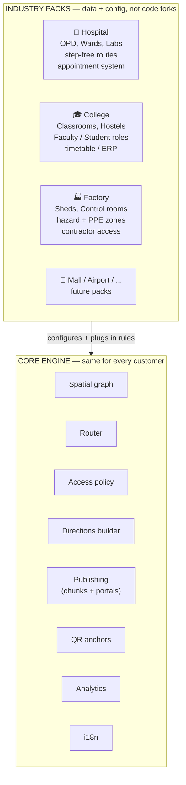

| | 🏥 Hospital | 🎓 College | 🏭 Factory |
|---|---|---|---|
| Categories | OPD, Wards, Labs, Pharmacy | Classrooms, Labs, Hostels, Library | Sheds, Stores, Control rooms, Assembly points |
| Default roles | Doctor, Nurse, Electrician, Visitor | Faculty, Student, Guard | Operator, Maintenance, Contractor, Safety officer |
| Route rules | Step-free / stretcher-width | — | Avoid hazard zones, PPE zones, forklift lanes |
| Integrations | Hospital management system (appointments) | Timetable / ERP | Shift system, contractor induction |

**Rule against forking:** if 2+ customers need it, it goes into the core or a pack as configuration. If 1 customer needs it, it becomes an integration or webhook. **Never a customer-specific code branch.**

---

## 2. System components

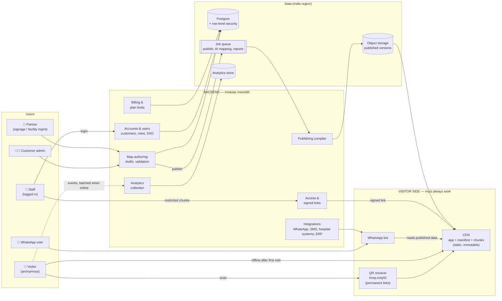

### Why a modular monolith (not microservices)
- One backend codebase, one deployment, **strict module boundaries**: each module exposes an interface, and nothing reaches into another module's tables.
- With 2 founders, microservices = 10 deployments and endless DevOps work.
- Modules can be split out later when volume needs it (analytics first). Because the boundaries are clean, that's mechanical work, not a rewrite.

---

## 3. Editing vs. delivery (write once, read millions of times)

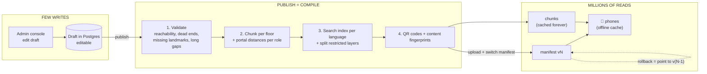

**Business effect:** the cost of each extra visitor ≈ ₹0 (CDN only) → **margins grow as we scale**. One-click rollback, preview before publishing.

---

## 4. Customer data model (multi-tenant)

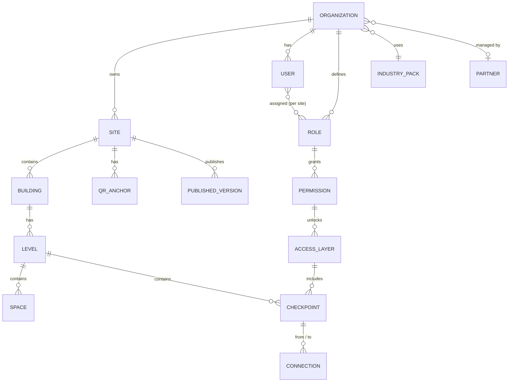

- **Organization** = the paying customer (e.g. a hospital chain). **Site** = a campus or plant. **One contract can cover many sites**, and those are the big deals.
- Roles can be limited to specific sites ("Electrician at the Chennai site only").
- **Compatible with Apple's IMDF format** (venue → level → unit) so we can export to it.
- **Separation:** shared database + row-level security by default → dedicated database per customer for government/defense/enterprise later (possible because the organization id is everywhere).

---

## 5. Visitor flow: QR → navigate → re-route

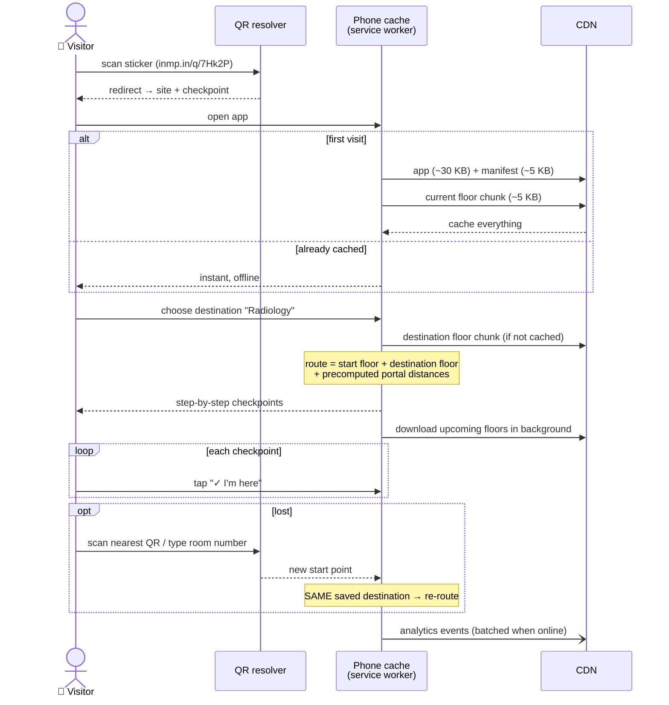

---

## 6. Staff flow: restricted access

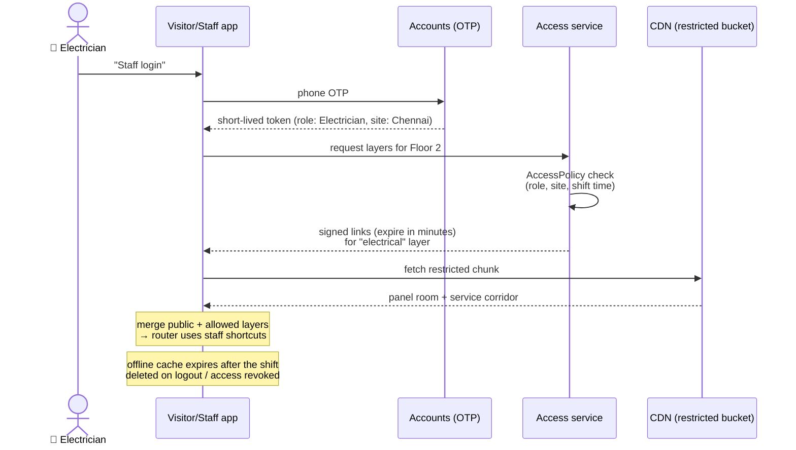

**Visibility levels:**

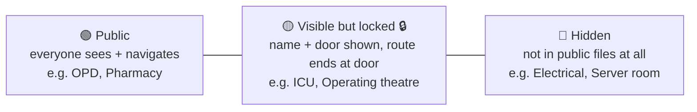

> ⚠️ We control **who sees information and directions**, not physical access. Locks and guards still guard doors.

---

## 7. Data delivery for huge campuses

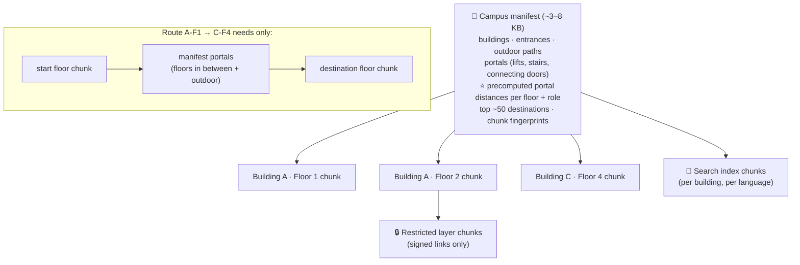

- Small buildings = **1 file** (on 2G, the number of requests matters more than size). Big campuses = split. The publishing step decides automatically.
- **Download ahead:** the route's floors + floors connected by lifts/stairs. **Data Saver / 2G** → only what's needed right now.
- **Content fingerprints in filenames** → cached forever. An edit = only the changed chunk is downloaded again.

---

## 8. Permanent QR links

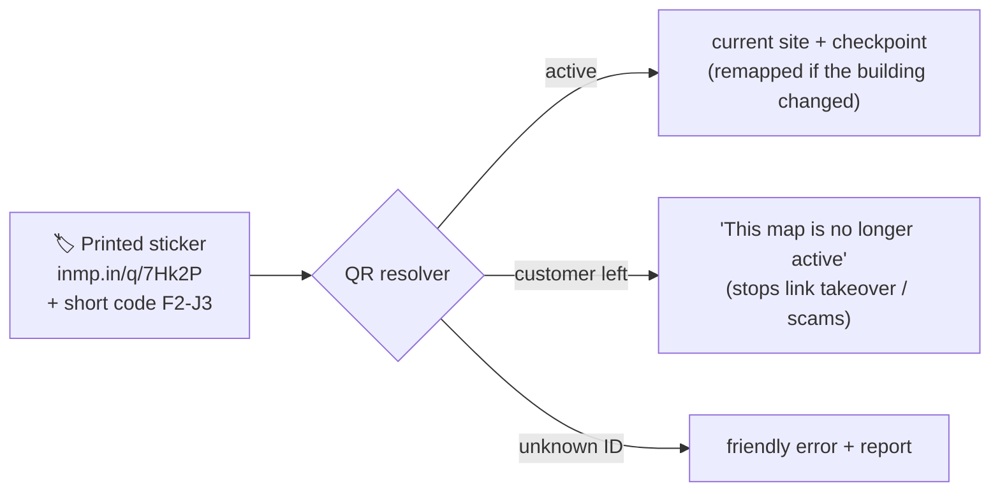

- QR codes **always** go through our short domain, even when the customer has a branded domain for their web links.
- The building is renovated → update the mapping, **never reprint stickers**.

---

## 9. Extension points (how industries plug in)

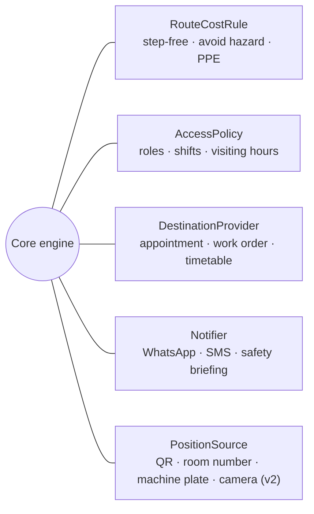

New industry = **new pack + maybe 1–2 new implementations**. The core stays untouched (Open/Closed principle).

---

## 10. Reliability: what breaks when the backend is down

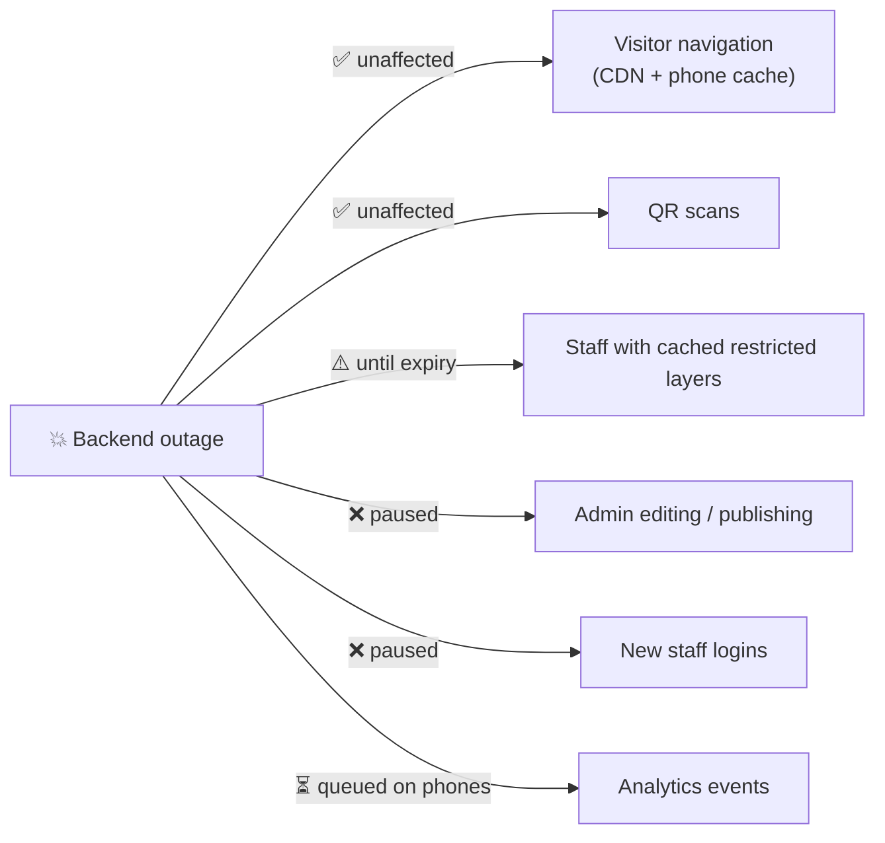

> Selling point: **"Our outages don't strand patients in your corridors."**

---

## 11. Data protection & compliance (India-first)

- **Minimal personal data:** visitors are anonymous; analytics are anonymous events → light obligations under the **DPDP Act, 2023**.
- **No medical data ever:** hospital integrations pass only "destination = OPD 12".
- **Data hosted in India** (Mumbai cloud region).
- **Self-hosted edition (later):** the visitor side is static → a bundle that runs on the customer's internal network (defense / high-security factories).
- Audit logs, staff access reviews, role-based admin access for enterprise sales checklists.

---

## 12. Business needs built into the architecture

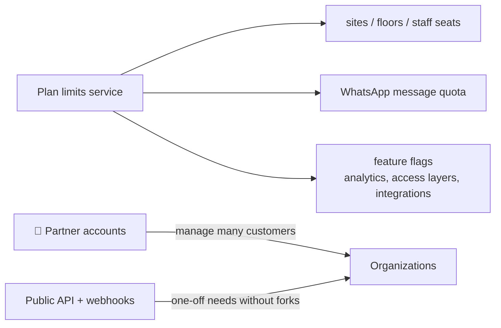

- **Pricing units:** main price per **site per month** · usage: **WhatsApp messages** (Meta charges per conversation, passed through with a margin) · add-ons: staff access layers, analytics, integrations.
- **Self-serve** for small colleges/clinics · **assisted onboarding** for chains and factories.
- **Partner channel:** signage, facility-management and fire-safety firms resell and do the mapping, which grows us without sales staff.

---

## 13. Build in stages

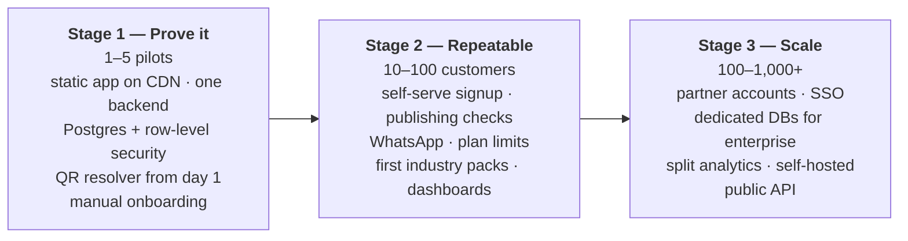

---

## 14. Tentative tech choices

| Area | Choice | Why |
|---|---|---|
| Language | TypeScript everywhere | One language, shared `packages/core` |
| Visitor app | Plain TypeScript, no framework | first screen ≤ 50 KB |
| Admin console | Preact / React | Staff use laptops; richer editor |
| Backend | Node.js / TypeScript modular monolith | Shares routing code with the client |
| Database | Postgres (India region) + row-level security | Customer separation enforced by the database |
| Edge / CDN | Cloudflare (Pages / Workers / R2) or similar | Static delivery, signed links, QR resolver at the edge |
| Jobs | Postgres-backed queue to start | No extra infrastructure at Stage 1 |
| Analytics | Postgres partitions → columnar store later | Don't over-build early |

---

## 15. Open decisions ❓

1. **First revenue industry** after the college pilot: hospitals or factories?
2. **Short QR domain + brand name** (buy early, e.g. `inmp.in`).
3. **Self-hosted edition:** real customer need now, or later?
4. **First partners:** any signage / facility-management contacts?
5. Cloud provider choice for the India region.
