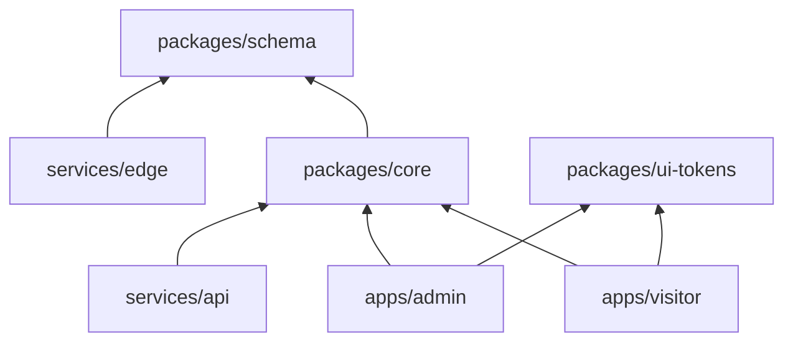
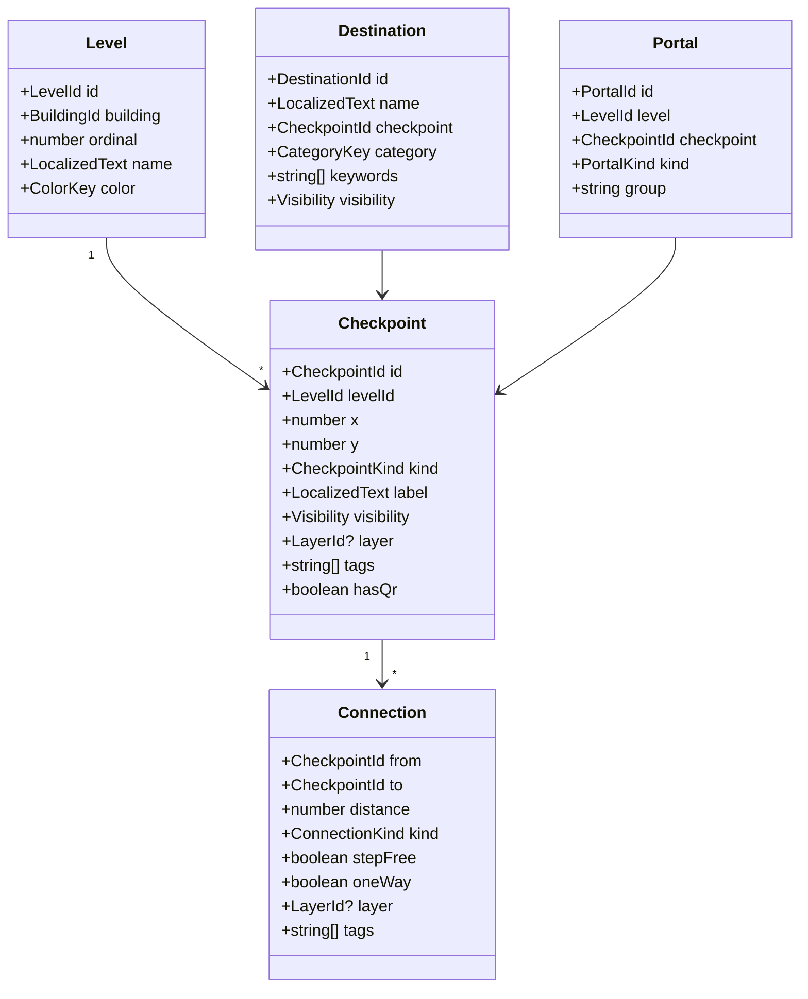
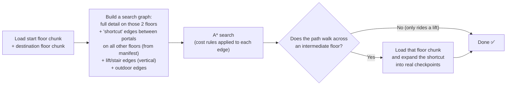
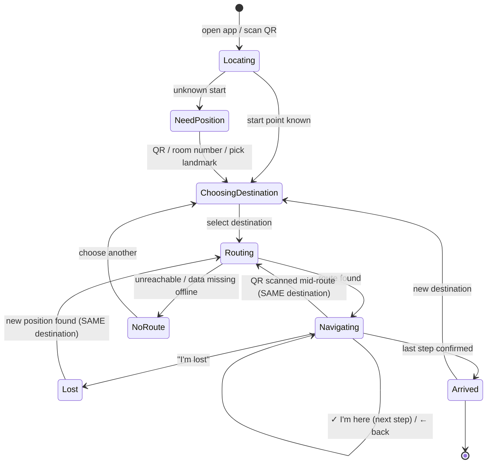
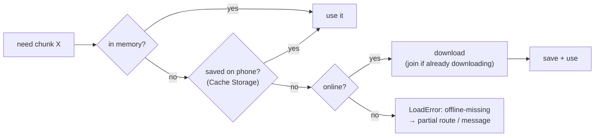
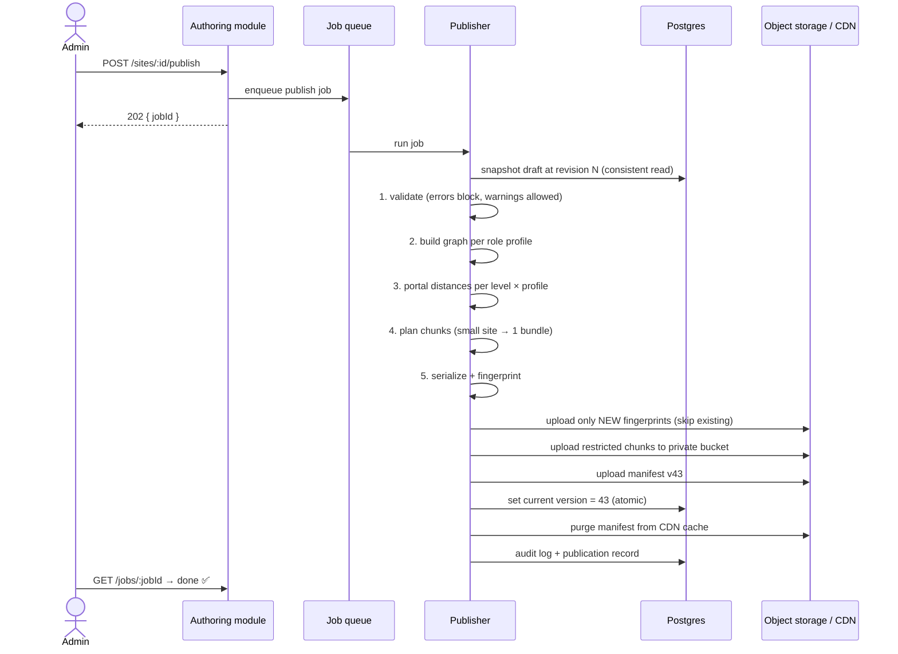
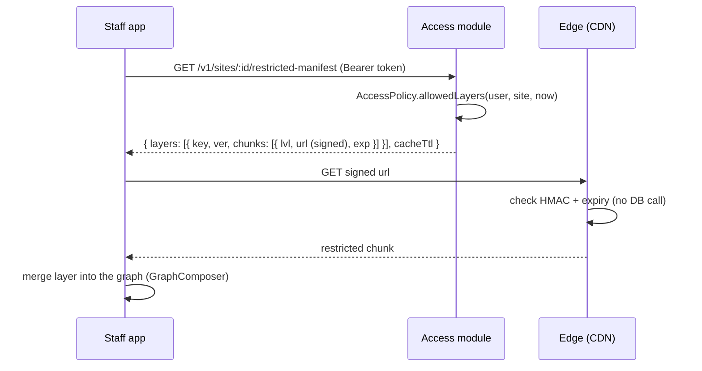
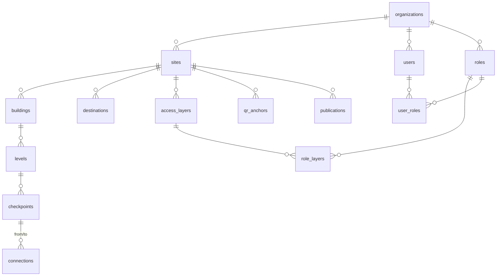

# Inner Map — Low-Level Design (LLD)

> How each piece works on the inside: folders, data formats, interfaces, algorithms, database tables, APIs.
> Companion to [`PROJECT_CONTEXT.md`](./PROJECT_CONTEXT.md) and [`HIGH_LEVEL_ARCHITECTURE.md`](./HIGH_LEVEL_ARCHITECTURE.md).
> Started: 2026-10-15 · Status: **design (proposed), no code yet**
>
> 💡 Every section starts with **"In simple words"** so it's readable without the technical detail.

---

## 1. Repository structure

> **In simple words:** one project folder, split into boxes. The shared "brain" (routing, rules) lives in one box, and every app uses that same box.

```
inner-map/
├─ packages/
│  ├─ core/              # 🧠 pure TypeScript — no browser, no server code
│  │  ├─ domain/         #   graph, routing, access, directions, position
│  │  ├─ usecases/       #   StartNavigation, Reroute, ConfirmCheckpoint, Search
│  │  └─ ports/          #   interfaces (ChunkLoader, Clock, Storage, Translator…)
│  ├─ schema/            # 📄 data formats + versions + converters + validation
│  └─ ui-tokens/         # 🎨 colors, spacing, SVG icon sheet
├─ apps/
│  ├─ visitor/           # 📱 ultra-light phone app (plain TS, first screen ≤ 50 KB)
│  └─ admin/             # 💻 map editor + dashboard (Preact)
├─ services/
│  ├─ api/               # 🏢 backend (modular monolith)
│  │  └─ modules/        #   accounts, authoring, publishing, access, qr,
│  │                     #   integrations, billing, analytics
│  └─ edge/              # ⚡ runs at the CDN: QR resolver, signed-link check
└─ tools/                # size-budget check, import scripts, seed data
```

**Enforced dependency rules** (a lint tool fails the build if they're broken):


- `core` **never** imports browser, server or database code.
- Apps never import each other.
- Backend modules talk only through each other's public interfaces, never each other's tables.

---

## 2. Core domain model

> **In simple words:** a building is stored as **dots (checkpoints)** joined by **lines (connections)**. Rooms people search for (destinations) point to a dot. Some dots and lines belong to a secret layer.



**Enumerations:**

| Type | Values |
|---|---|
| `CheckpointKind` | `entrance`, `junction`, `door`, `lift`, `stairs`, `ramp`, `escalator`, `landmark`, `exit` |
| `ConnectionKind` | `walk`, `stairs`, `lift`, `ramp`, `escalator`, `outdoor` |
| `Visibility` | `public`, `locked` (shown with 🔒, route ends at the door), `hidden` (only in restricted layers) |
| `PortalKind` | `lift`, `stairs`, `building-door`, `outdoor-gate` |

**Coordinates:** meters, local to each level. `x` → east, `y` → south (same direction as SVG). Each level has a transform into site coordinates for outdoor paths.

**IDs:** short strings in published data (`A-G-J3`), UUIDs in the database. The publisher maps between them.

---

## 3. Interfaces (the extension points)

> **In simple words:** "sockets" where new features plug in. Adding a feature means **plugging something new into a socket**, not rewiring the house.

```ts
// ---- How we know where the user is ----
interface PositionSource {
  readonly kind: 'qr' | 'room-number' | 'landmark-pick' | 'camera';
  resolve(input: string, ctx: SiteContext): Promise<Result<CheckpointId, PositionError>>;
}

// ---- How a connection's cost is adjusted (step-free, avoid hazards…) ----
interface RouteCostRule {
  readonly id: string;
  /** Return the new cost. Infinity = forbidden. Return baseCost to leave it unchanged. */
  adjust(edge: Connection, baseCost: number, ctx: RouteContext): number;
}

// ---- Who can see/use what ----
interface AccessPolicy {
  allowedLayers(user: Principal, site: SiteId, at: Date): LayerId[];
  canSee(item: { visibility: Visibility; layer?: LayerId }, user: Principal): boolean;
}

// ---- Getting map data (network / cache / bundled are interchangeable) ----
interface ChunkLoader {
  manifest(site: SiteId): Promise<Result<Manifest, LoadError>>;
  levelChunk(ref: ChunkRef, priority: 'now' | 'prefetch'): Promise<Result<LevelChunk, LoadError>>;
}

// ---- Turning a path into human directions ----
interface InstructionBuilder {
  build(path: PathSegment[], locale: Locale): Step[];
}

// ---- Small utilities (swapped for fakes in tests) ----
interface Clock { now(): number }
interface KeyValueStore { get<T>(k: string): T | null; set<T>(k: string, v: T): void; del(k: string): void }
interface Translator { t(key: string, params?: Record<string, string>, locale?: Locale): string }
interface EventBus { emit(e: AppEvent): void; on<T extends AppEvent['type']>(t: T, fn: (e: Extract<AppEvent, {type: T}>) => void): () => void }
```

**Coding rules:**
- Domain functions **return `Result<T, E>`** instead of throwing, so errors are visible in the types.
- No `any`. Input from outside (API, files, URLs) is validated at the boundary with a schema validator.
- **One "composition root"** per app (`main.ts`) creates the real implementations and passes them in. That's the only place that knows which concrete class is used.

### Industry rules are data, not code (keeps the visitor app small)
Instead of shipping factory-specific code to phones, a few **generic, configurable rules** live in core. Packs only provide settings:

```json
// factory pack → manifest.rules
[
  { "rule": "avoid-tags",  "tags": ["hazard", "forklift-lane"], "mode": "forbid" },
  { "rule": "penalize-tags", "tags": ["ppe-required"], "factor": 3 },
  { "rule": "step-free",   "when": "profile.stepFree" }
]
```

| Generic rule | Does |
|---|---|
| `step-free` | Forbids `stairs`/`escalator`, prefers `lift`/`ramp` |
| `avoid-tags` | Forbids connections with given tags |
| `penalize-tags` | Multiplies cost for given tags |
| `prefer-public` | Staff routes prefer public corridors unless a shortcut is much shorter |
| `one-way` | Respects one-way connections (factories, hospital flows) |

---

## 4. Published data formats (what phones download)

> **In simple words:** the "newspaper" has a **small index page (manifest)** and **separate pages per floor (chunks)**. The phone reads the index first, then only the pages it needs.

### 4.1 Manifest — `/{site}/m.json` (~3–8 KB, short cache, re-checked when online)

```json
{
  "fmt": 1,
  "site": "city-hospital",
  "ver": 42,
  "pub": "2026-10-15T10:00:00Z",
  "pack": "hospital",
  "locales": ["en", "hi"],
  "name": { "en": "City Hospital", "hi": "सिटी हॉस्पिटल" },
  "theme": { "brand": "#0E7C86" },
  "rules": [{ "rule": "step-free", "when": "profile.stepFree" }],
  "levels": [
    { "id": "A-G", "b": "A", "ord": 0, "name": { "en": "Ground" }, "color": "teal", "chunk": "c/A-G.3fa9c1.json" },
    { "id": "A-2", "b": "A", "ord": 2, "name": { "en": "Floor 2" }, "color": "violet", "chunk": "c/A-2.77b0e2.json" }
  ],
  "portals": [
    ["A-L1@G", "A-G", "lift", "A-L1"],
    ["A-L1@2", "A-2", "lift", "A-L1"]
  ],
  "vertical": [
    ["A-L1", "lift", ["A-G", "A-1", "A-2"], 20, 8, true]
  ],
  "portalDist": {
    "public": { "A-G": [["A-E1", "A-L1@G", "A-S1@G"], [0, 18, 25, 18, 0, 12, 25, 12, 0]] }
  },
  "outdoor": [],
  "top": [["rad", { "en": "Radiology", "hi": "रेडियोलॉजी" }, "A-2", "A-2-R7", "lab"]],
  "search": { "A": { "en": "s/A.en.91c2aa.json", "hi": "s/A.hi.4d10fe.json" } }
}
```
- `fmt` = **data format version** (can the app read this?). `ver` = **publish number** (which edition is this?).
- `vertical` = lift/stair groups: `[group, kind, levels served, fixed cost, cost per floor, stepFree]`.
- `portalDist` = for each level, the portal list + a flattened distance matrix, **per role profile**.
- ⚠️ **The public manifest contains nothing about restricted layers**, not even their names. Staff get a separate restricted manifest from the API (section 9).

### 4.2 Level chunk — `/{site}/c/A-2.77b0e2.json` (~2–10 KB, cached forever)

```json
{
  "fmt": 1,
  "lvl": "A-2",
  "str": ["Pharmacy counter (green board)", "Lift lobby", "Radiology reception"],
  "cp": [
    ["A-2-J3", 30, 18, "junction", 0, 1, []],
    ["A-L1@2", 30, 40, "lift",     1, 1, []],
    ["A-2-R7", 52, 18, "door",     2, 0, []]
  ],
  "ed": [
    ["A-L1@2", "A-2-J3", 22],
    ["A-2-J3", "A-2-R7", 22, "walk", 1]
  ],
  "dest": [["rad", "A-2-R7", "lab"]]
}
```
- `cp` = `[id, x, y, kind, labelIndex, hasQr, tags]`. Labels are stored once in `str` (a string table) to save bytes.
- `ed` = `[from, to, distance, kind = "walk", stepFree = 1, tags = []]`. Trailing defaults are omitted.
- Translations: `str` holds the default locale. Other locales come as small `str` files per level, loaded only if needed.

### 4.3 Versioning rules
- The app supports a range: `MIN_FMT ≤ fmt ≤ MAX_FMT`.
- Older `fmt` → converted in `packages/schema/migrations`.
- Newer `fmt` → the app shell updates itself first (service worker), then reads it.
- File names contain a **content fingerprint** (first 6–10 hex digits of a SHA-256 of the content). Same name = same content forever.

---

## 5. Routing algorithm

> **In simple words:** the phone works out the shortest path like a GPS app, but it only needs **the floor you're on + the floor you're going to**. For the floors in between, it uses distances that were calculated in advance.

### 5.1 Two-level routing



- **A\*** = Dijkstra plus a "guess" (straight-line distance to the destination) that makes it faster. On different floors, the guess uses the lift cost so it never overestimates.
- **Edge cost** = `distance × kind factor`, then each `RouteCostRule` in order. `Infinity` = forbidden.

| Kind | Default cost |
|---|---|
| `walk` | distance |
| `stairs` | distance × 2 + 10 per floor |
| `lift` | 20 (waiting) + 8 per floor |
| `ramp` | distance × 1.2 |
| `escalator` | distance × 0.8 + 5 |

(Admins can tune these per site. Hospitals often want "always prefer lifts".)

### 5.2 Portal distances (computed when publishing)
For each level × each role profile:
1. Run Dijkstra from every portal on that level, using **only that level's** connections (plus that role's layers).
2. Store the portal-to-portal distance matrix in the manifest.
3. Size: a level with 10 portals → 100 numbers. Small.

Role profiles = `public` + one per role that has layers (e.g. `electrical`). **Not every combination of permissions**: a user with several roles gets the profile with the most access, or falls back to loading full floor chunks.

### 5.3 Turning a path into directions (`InstructionBuilder`)
1. Walk along the path and **merge straight segments** (no new step for every dot in a straight corridor).
2. At each corner, compute the **turn angle** between incoming and outgoing direction:

| Angle | Instruction |
|---|---|
| < 30° | Go straight |
| 30°–60° | Slight left/right |
| 60°–150° | Turn left/right |
| > 150° | Turn around |

3. **A floor change becomes 3 steps:** "Go to Lift A (near reception)" → "Take the lift to Floor 2 🟣" → "Exit the lift and turn left".
4. **Always mention a landmark:** "Turn LEFT at the Pharmacy counter (green board)".
5. Text comes from **translation templates**: `turn.left.at = "Turn LEFT at {landmark}"` / Hindi: `"{landmark} पर बाएं मुड़ें"`.
6. The last step: "Radiology reception is on your RIGHT 🎉". If it's `locked`: "This is a staff-only area 🔒. Please ask at the door."

**Implemented in Phase 3** (`packages/core/src/directions/`), with these decisions:
- A step **starts where the visitor must turn** and says "{turn} and walk to {next landmark}", so the turn happens where they are standing when they read it.
- Straight stretches merge; passed landmarks appear as "walk **past** X to Y". After **30 m** without a step, a named landmark gets a reassurance step.
- An unnamed turn point is described by distance ("the corner about 6 m ahead"). The editor checks (Phase 8) should push admins to name it.
- **Lift exit assumption:** people turn around inside a lift and leave through the same door, so the exit heading = entry heading + 180°. Stairs exits have no assumed heading ("On Floor 2, walk to…"). Lifts with doors on both sides will need a per-stop facing later.
- Consecutive flights of the same staircase merge into one step ("Use the East staircase to go up to Floor 2").
- A final hop of **≤ 6 m into a door** becomes the arrival side ("on your LEFT / RIGHT / straight ahead").
- The last step is always `arrive`, which is **the Arrived screen's message**, not a card to confirm.
- Templates are whole sentences with `{placeholders}` (`packages/core/src/i18n/en.ts`). Hindi must provide every key (checked by the compiler).

---

## 6. Navigation state machine (visitor app)

> **In simple words:** the app is always in exactly **one mode** (choosing, navigating, lost, arrived), and only certain actions move it between modes. This prevents weird half-states.



**Session saved on the phone** (`localStorage` key `im.session`):
```json
{ "site": "city-hospital", "ver": 42, "dest": "rad", "start": "A-E1",
  "route": ["A-E1", "A-L1@G", "A-L1@2", "A-2-J3", "A-2-R7"], "step": 2,
  "profile": { "stepFree": false }, "ts": 1760522400000 }
```
- **Expires after 3 hours** (an old hospital visit shouldn't come back next week).
- A QR scan from **the same site** with an active session → reroute to the same destination.
- A scan from **a different site** → "Start a new navigation here?"

### "I'm lost" recovery (in order)
1. **Scan a QR** (opens the camera, or the user scans with their own camera app).
2. **Type a room number** → `RoomNumberSource` matches door labels and short codes.
3. **"Do you see any of these?"** → the 4–6 checkpoints nearest the last confirmed one, by landmark text.

---

## 7. Loading and caching data (visitor app)

> **In simple words:** the phone first checks its own memory, then its saved copies, and only then the internet. While you walk, it quietly downloads what you'll need next.

### 7.1 `ChunkLoader` lookup order

- **In-memory LRU:** keeps the last ~6 floor chunks in memory.
- **Duplicate requests are merged:** two parts of the app asking for the same chunk = 1 download.
- **Priority queue:** `now` requests go before `prefetch` ones. At most 2 downloads in parallel on 2G, 4 otherwise.

### 7.2 Service worker cache strategies
| What | Strategy | Notes |
|---|---|---|
| App shell (HTML, JS, CSS, icons) | **Precache**, versioned | Updated on the next visit after a new app release |
| Manifest `m.json` | **Network first, 2 s timeout → cached copy** | Visitors always get a map, fresh when possible |
| Level / search chunks | **Cache first** (never changes) | Content fingerprint in the name |
| Restricted chunks | Separate cache `rx:{userId}` | Has an expiry time, deleted on logout/revocation |

### 7.3 Downloading ahead (prefetch)
| When | Prefetch |
|---|---|
| QR scanned | Floors connected to this one by lifts/stairs |
| Route calculated | All floors along the route |
| User opens search | Search index for the current building |
| `saveData` on, or 2G | **Nothing extra.** Only what's needed right now |

### 7.4 Storage limits
- Ask the browser to keep our storage: `navigator.storage.persist()`.
- Budget **~2 MB per site**. Over budget → remove the least-recently-used chunks (never the current site's manifest).
- Sites not opened for 60 days are cleaned up automatically.

---

## 8. Publishing pipeline (backend)

> **In simple words:** pressing **Publish** = check the map for mistakes → cut it into floor pages → calculate shortcuts → upload → switch everyone to the new edition. Old editions are kept for undo.



### Validation rules
| Rule | Level |
|---|---|
| Every public checkpoint reachable from at least one entrance | ❌ error |
| Every destination points to an existing checkpoint | ❌ error |
| Duplicate QR codes / short codes | ❌ error |
| A restricted layer has no connection to the public graph | ❌ error |
| A `locked` destination isn't at a public door | ❌ error |
| Checkpoint with no landmark text or a generic one ("Junction 7") | ⚠️ warning |
| Walk connection longer than 40 m with no checkpoint in between | ⚠️ warning |
| Missing translation for an enabled language | ⚠️ warning |
| Lift/stairs group serves only one level | ⚠️ warning |

### Chunk planning
- Whole site compressed < **25 KB** → **one bundle file** (fewer requests on 2G).
- Otherwise → one chunk per level. A level > 15 KB compressed → split by zone (later).

### Rollback
`POST /sites/:id/rollback { version: 42 }` → point the current version back to 42 and purge the cached manifest. Nothing is rebuilt.

---

## 9. Auth and restricted access

> **In simple words:** staff log in with an OTP and get a **short-lived pass**. The pass lets them ask for the secret floor pages, which come as **links that expire in minutes**.

### 9.1 Tokens
| Token | Lifetime | Stored | Contains |
|---|---|---|---|
| Access token (JWT) | 15 min | memory | `sub`, `org`, `roles`, `sites`, `exp` |
| Refresh token | 30 days, **rotates on every use** | HttpOnly cookie | opaque id (looked up in the DB, can be revoked) |
| Signed chunk link | 5 min | — | `path`, `exp`, `uid`, HMAC signature |

### 9.2 Getting restricted data


### 9.3 Merging layers (`GraphComposer`)
- Base graph (public chunk) + each allowed layer chunk → **one combined graph**, built without changing the base data.
- Layer checkpoints attach to public checkpoints through layer connections.
- The **router is unaware of layers**. It just sees a bigger graph.

### 9.4 OTP safety
- Max 3 OTP requests per phone per 10 min and 10 per day. Per-IP limits too.
- OTP is 6 digits, valid 5 min, max 5 tries, stored only as a hash.
- Only phone numbers **pre-registered by the organization admin** can log in. No open signup for staff.

---

## 10. Database schema (Postgres)

> **In simple words:** every table has an `org_id` column, and the database itself refuses to show one customer's rows to another.



| Table | Key columns |
|---|---|
| `organizations` | `id`, `name`, `industry_pack`, `plan_id`, `partner_id?`, `settings jsonb`, `status` |
| `sites` | `id`, `org_id`, `slug` (unique), `name jsonb`, `timezone`, `default_locale`, `draft_rev`, `current_version` |
| `buildings` | `id`, `org_id`, `site_id`, `code`, `name jsonb` |
| `levels` | `id`, `org_id`, `building_id`, `ordinal`, `name jsonb`, `color`, `floorplan_asset_id?`, `scale`, `transform jsonb` |
| `checkpoints` | `id`, `org_id`, `level_id`, `code`, `x`, `y`, `kind`, `label jsonb`, `visibility`, `layer_id?`, `tags text[]` |
| `connections` | `id`, `org_id`, `from_id`, `to_id`, `kind`, `distance`, `step_free`, `one_way`, `layer_id?`, `tags text[]` |
| `destinations` | `id`, `org_id`, `site_id`, `checkpoint_id`, `name jsonb`, `category`, `keywords text[]`, `visibility`, `layer_id?` |
| `access_layers` | `id`, `org_id`, `site_id`, `key`, `name`, `cacheable`, `cache_ttl_minutes` |
| `roles` / `role_layers` | role → which layers it unlocks |
| `users` / `user_roles` | `user_roles.site_id?` limits a role to one site |
| `qr_anchors` | `code` (PK, 7-char base58), `org_id`, `site_id`, `checkpoint_id`, `status` (`active`/`retired`/`org-inactive`), `printed_at` |
| `publications` | `id`, `org_id`, `site_id`, `version`, `fmt`, `draft_rev`, `manifest_key`, `report jsonb`, `created_by`, `created_at` |
| `audit_log` | `id`, `org_id`, `actor_id`, `action`, `target`, `meta jsonb`, `at` (append-only) |
| `analytics_events` | partitioned by month: `site_id`, `ver`, `type`, `cp?`, `dest?`, `session`, `at` |
| `jobs` | Postgres-backed queue: `id`, `type`, `payload`, `status`, `attempts`, `run_at` |
| `entitlements` | `plan_id` → limits (`sites`, `levels`, `staff_seats`, `wa_messages`) + feature flags |

### Row-level security
```sql
ALTER TABLE checkpoints ENABLE ROW LEVEL SECURITY;
CREATE POLICY org_isolation ON checkpoints
  USING (org_id = current_setting('app.org_id')::uuid);
```
- The API sets `app.org_id` at the start of every request transaction.
- **Automated test:** for every table, log in as org A and confirm org B's rows are invisible.

### Editing conflicts (two admins at once)
- Every edit sends the `draft_rev` it started from. If the database has moved on → `409 Conflict` → the editor reloads that level and shows what changed.
- Optional soft **lock per level** ("Priya is editing Floor 2").

---

## 11. API (REST, versioned `/v1`)

> **In simple words:** the list of "requests" the apps can make to our backend, and who is allowed to make each one.

### Public (no login)
| Method | Path | Purpose |
|---|---|---|
| GET | `/q/:code` | **QR resolver** (at the edge) → 302 to `/s/:site/?at=:checkpoint` |
| GET | `/s/:site/...` | Static app + published data (CDN) |
| POST | `/v1/events` | Anonymous analytics batch (max 50 events, rate-limited) |
| POST | `/v1/feedback` | "This is wrong" reports |

### Staff
| Method | Path | Purpose |
|---|---|---|
| POST | `/v1/auth/otp/request` | `{ phone, org }` |
| POST | `/v1/auth/otp/verify` | → access token + refresh cookie |
| POST | `/v1/auth/refresh` / `/v1/auth/logout` | Rotate / revoke |
| GET | `/v1/sites/:id/restricted-manifest` | Allowed layers + signed links |

### Admin
| Method | Path | Purpose |
|---|---|---|
| CRUD | `/v1/sites`, `/buildings`, `/levels`, `/checkpoints`, `/connections`, `/destinations` | Edit the draft |
| POST | `/v1/levels/:id/floorplan` | Upload a floor-plan image |
| POST | `/v1/sites/:id/validate` | Dry-run validation report |
| POST | `/v1/sites/:id/publish` | → `202 { jobId }` |
| GET | `/v1/jobs/:id` | Job status |
| POST | `/v1/sites/:id/rollback` | `{ version }` |
| CRUD | `/v1/qr-anchors` · GET `/v1/sites/:id/qr-sheet.pdf` | Create and print stickers |
| CRUD | `/v1/roles`, `/v1/users`, `/v1/access-layers` | Access management |
| GET | `/v1/sites/:id/insights` | "Where do people get lost?" dashboard |
| GET | `/v1/audit` | Audit log |

**Errors** use one standard shape (RFC 9457 "problem details"):
```json
{ "type": "https://errors.innermap.in/draft-conflict", "title": "Draft changed",
  "status": 409, "code": "DRAFT_CONFLICT", "detail": "Floor 2 was edited by another admin." }
```

---

## 12. QR resolver (edge)

> **In simple words:** a tiny program at the CDN that reads the sticker code and sends the person to the right place in milliseconds.

```
GET /q/7Hk2P
  1. look up code in edge key-value cache (fallback: API)
  2. active        → 302 /s/city-hospital/?at=A-G-E1&src=qr
     retired       → 302 to the replacement checkpoint (if remapped)
     org-inactive  → "This map is no longer active" page
     unknown       → friendly error page + log
```
- Codes are **7 characters of base58** (no confusing 0/O/l/I). That's ~2 trillion combinations, so they're hard to guess by stepping through numbers.
- The short code printed under the QR (e.g. `F2-J3`) is **separate**. It's typed inside an already-open site, so it only needs to be unique within that site.

---

## 13. Analytics events

> **In simple words:** small anonymous notes like "someone got lost here", saved on the phone and sent in a batch later.

| Event | Fields |
|---|---|
| `scan` | `cp`, `src` (`qr`/`link`/`wa`) |
| `dest_select` | `dest`, `from` (`search`/`top`/`category`) |
| `step_confirm` | `cp`, `step`, `ms_since_prev` |
| `lost` | `cp` (last confirmed), `step` |
| `reroute` | `from_cp`, `new_cp`, `method` |
| `arrive` | `dest`, `total_ms`, `steps` |
| `abandon` | `step` (session expired without arriving) |

- Common fields: `site`, `ver`, `session` (random per navigation, **not per device**), `ts`.
- Queued in `localStorage` (max 200), sent with `navigator.sendBeacon` when online.
- **No personal data. No device id.**

---

## 14. Visitor app internals

> **In simple words:** plain screens, no heavy framework, redrawn only when something changes.

```
apps/visitor/src/
├─ main.ts                # composition root: wire the real implementations
├─ state/store.ts         # tiny store (state machine + subscribe)
├─ views/                 # Home, Search, Step, Lost, Arrived, MapSketch
├─ components/            # StepCard, FloorBadge, ProgressDots, Icon
├─ infra/                 # FetchChunkLoader, LocalStore, SWBridge, BeaconAnalytics
├─ sw.ts                  # service worker
└─ styles/                # tokens.css, base.css, components.css
```
- **Rendering:** each view is a function `(state) => HTMLElement`, updating only the parts that changed. No virtual DOM library.
- **Map sketch:** an SVG built from checkpoint coordinates of the current level only. Route = one `<path>`. The future "draw-on" animation uses `stroke-dashoffset`.
- **Accessibility:** buttons ≥ 48 px, contrast ≥ 4.5:1, `aria-live` on the step text, honors `prefers-reduced-motion`.

| Budget (compressed) | Limit |
|---|---|
| JS | ≤ 22 KB |
| CSS | ≤ 6 KB |
| HTML + icon sheet | ≤ 7 KB |
| **First screen** (what index.html loads) | **≤ 50 KB** (CI fails above this; was 35 KB until 2026-10-18) |
| Screens loaded right after it | ≤ 15 KB |
| First visit (all app files + largest map) | ≤ 65 KB |

---

## 15. Testing strategy

| Layer | What | How |
|---|---|---|
| Core routing | Known routes on sample buildings ("golden routes") | Unit tests |
| Core access | **A public route never uses a restricted edge** (any random graph) | Property-based tests |
| Directions | Turn angles, floor-change steps, translations | Unit + snapshot tests |
| Schema | Every old `fmt` converts and loads | Migration tests |
| Publisher | Same draft → same output files (deterministic) | Snapshot tests |
| Database | Org A can't read org B, for every table | Integration tests |
| Visitor e2e | Scan → route → lost → reroute → arrive on **2G + 4× slower CPU** | Playwright |
| Offline | Second visit with network off still navigates | Playwright |
| Size | First screen ≤ 50 KB, later chunks ≤ 15 KB, first visit ≤ 65 KB | CI script |

---

## 16. Open LLD decisions ❓

1. **Coordinates:** start with meters measured from the floor-plan scale, or plain image pixels with a scale factor?
2. **One bundle vs. chunks threshold:** is 25 KB compressed right? We should test on a real 2G phone.
3. **Lift vs. stairs default costs:** hospitals want lifts; colleges might prefer stairs for 1 floor. Do we need per-pack defaults?
4. **Staff with multiple roles:** precompute combined profiles, or just load full chunks for them?
5. **Admin editor:** draw directly on the floor-plan image (Canvas) or with SVG? SVG is simpler; Canvas is faster for huge campuses.
