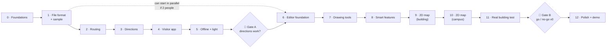

# Inner Map — Build Phases (Prototype)

> Step-by-step plan to build the prototype described in [`PROTOTYPE.md`](./PROTOTYPE.md).
> Each phase is small, ends with **something we can see or test**, and doesn't start until the previous one is "done".
> Started: 2026-10-15 · Status: **not started**

---

## Overview

> **In simple words:** first we build the **brain** (how routes and directions are calculated), then the **phone app** that uses it, test it with real people, and only *then* build the **map editor**. Finally, we map a real building and test everything together.

| Phase | Name | What you can see at the end | Rough effort* |
|---|---|---|---|
| **0** | Foundations | Empty apps run, checks are automatic | 1 day |
| **1** | Map file format + sample building | A hand-made 3-floor "Demo Hospital" file that passes validation | 1–2 days |
| **2** | Routing brain | Tests prove correct routes across floors, step-free, nearest toilet | 2–3 days |
| **3** | Directions brain | Routes turn into readable steps: "Turn LEFT at the Pharmacy (green board)" | 2 days |
| **4** | Visitor app | On a real phone: scan → search → steps → lost → re-route → arrived | 3–4 days |
| **5** | Offline + light + slow-phone test | Works in airplane mode; ≤ 50 KB first visit; smooth on a cheap phone on 2G | 1–2 days |
| 🚦 | **Gate A: "Do the directions work?"** | 2–3 people navigate the demo map successfully | ½ day |
| **6** | Editor foundation | Floors, floor-plan images, zoom/pan, scale, undo/redo, save/load | 2–3 days |
| **7** | Editor drawing tools | Draw paths, drag dots, doors, rooms, lifts/stairs across floors | 3–4 days |
| **8** | Editor smart features | Amenity drag-and-drop, QR stickers + print sheet, live checks, ▶ test route | 3 days |
| **9** | 2D map — inside a building | Google-Maps-style floor plan on the phone: walls, rooms, doors, stairs, blue route line, floor picker | 4–5 days |
| **10** | 2D map — campus view | Outdoor map of buildings, roads, grounds; routes between buildings | 3–4 days |
| **11** | Real building field test | A real building mapped in < 2 h; 5 strangers tested on real phones | 2–3 days |
| 🚦 | **Gate B: "Go / no-go for v0"** | Findings written down, v0 decisions made | ½ day |
| **12** | Polish + stretch + demo | Hindi, parking spot, demo link, pitch-ready | 2–3 days |

\* *Focused working days, rough. Real calendar time depends on hours per week.* **Total ≈ 6–8 focused weeks.**

**Critical path:** 0 → 1 → 2 → 3 → 4 → 5 → Gate A → 6 → 7 → 8 → 9 → 10 → 11.
If two people work in parallel, **the editor (6–8) can start right after Phase 1**, because both apps share the same file format.

---

## ✅ "Done" means the same thing in every phase

A phase is done only when **all** of these are true:
- [ ] It works and has been **shown** (demo on screen or phone)
- [ ] Tests pass (`pnpm test`), lint passes (`pnpm lint`)
- [ ] Visitor app is within the **size budget** (`pnpm size`)
- [ ] No `any`, no shortcuts that break the layer rules (core never imports browser code)
- [ ] Docs updated if a decision changed (`PROJECT_CONTEXT.md` / `LOW_LEVEL_DESIGN.md`)
- [ ] Committed with a clear message
- [ ] **Pushed to GitHub and CI is green** (`git push`, then check the Actions tab)

---

## Phase 0 — Foundations

> **In simple words:** set up the empty workshop: folders, tools, and automatic checks, so every later phase is fast and clean.

**Tasks**
- [x] `git init`, `.gitignore`, `.editorconfig`, `.nvmrc` (Node 24 LTS)
- [x] pnpm workspaces: `packages/core`, `packages/schema`, `apps/visitor`, `apps/editor`, `samples/`, `tools/`
- [x] TypeScript strict config shared by all packages
- [x] Vitest (tests), ESLint + Prettier, dependency-cruiser (layer rules)
- [x] `apps/visitor`: Vite + plain TS "Hello" page
- [x] `apps/editor`: Vite + Preact "Hello" page
- [x] `tools/size-check.mjs`: compresses the visitor build and **fails above 35 KB**
- [x] Root scripts: `pnpm dev`, `pnpm test`, `pnpm lint`, `pnpm size`, `pnpm build`
- [x] GitHub repo + GitHub Actions running lint → test → size → build ([deepak71kr/indoor-maps](https://github.com/deepak71kr/indoor-maps), first CI run green)
- [x] Short `README.md` pointing to the design docs

**Done when:** `pnpm dev` opens both apps, CI is green, and a deliberately oversized file makes the size check fail.

**Risk:** spending too long on tooling. **Rule: max 1 day, keep it boring.**

---

## Phase 1 — Map file format + sample building

> **In simple words:** decide exactly **what a map file looks like**, and hand-write a small 3-floor hospital in that format so we can build everything else against it.

**Tasks**
- [x] `packages/schema`: TypeScript types for `fmt: 0` (levels, nodes, edges, connectors, rooms, amenities, qr), per `PROTOTYPE.md` §4
- [x] Zod validation for the file (wrong/missing fields → clear error messages)
- [x] ID rules (unique ids, edges point to existing nodes, connector stops exist on their levels)
- [x] `samples/demo-hospital/map.json`, hand-written:
  - 3 floors (Ground, 1, 2), each with a color
  - 1 lift (G, 1, 2), 1 staircase (G–1–2), 1 lift that **skips floor 1** (to test that case)
  - 17 rooms (OPD, Radiology, Pharmacy, Lab, Canteen…), 2 rooms with **2 doors** (Radiology, Emergency)
  - Amenities: toilets (incl. accessible), water, ATM
  - 8–10 QR anchors with wall direction
  - Landmark names on all decision points
- [x] A simple diagram (ASCII or SVG) of the demo building in `samples/demo-hospital/README.md`
- [x] Tests: the sample is valid; broken samples produce the expected errors

**Done when:** `pnpm test` validates the demo file, and breaking it on purpose shows a readable error.

**Why first:** the editor, the phone app and the brain all depend on this format. Changing it later is expensive.

---

## Phase 2 — Routing brain (`packages/core`)

> **In simple words:** the code that answers "what's the best way from here to there?". Pure logic, no screens, fully tested.

**Tasks**
- [x] **Graph builder:** map file → dots + lines in memory; distances computed from coordinates
- [x] **Connectors → lines:** lift = a line between every pair of its floors; stairs = neighboring floors only
- [x] **Edge costs** (walk / stairs / lift / ramp) as in `LOW_LEVEL_DESIGN.md` §5
- [x] **`RouteCostRule` interface** + first rules: `step-free`, `avoid-tags`
- [x] **A\* search** across floors
- [x] **Multi-door destinations:** route to the cheapest door of a room
- [x] **Nearest amenity:** "nearest 🚻 from here" (first one reached by walking, not straight-line)
- [x] **Result types** (`ok` / `no-route` / `unknown-start`…), no exceptions
- [x] **Tests:**
  - Golden routes on the demo hospital (same floor, other floor, skipped floor)
  - Step-free route never uses stairs
  - Room with 2 doors → the closer door is chosen
  - Nearest toilet from 3 different spots
  - Unreachable destination → `no-route`
  - Speed: 1,000 random routes on the demo map in < 1 s

**Done when:** all tests pass and a tiny command prints a route (`pnpm route G-MAIN Radiology`).

**Open product question (for Phase 4):** "Nearest toilet" currently means only `toilet`, so from Floor 2 it sends you downstairs even though an accessible toilet is 32 m away on the same floor. Proposal: the 🚻 chip searches both `toilet` and `toilet-accessible`; the ♿ toggle restricts to accessible ones.

---

## Phase 3 — Directions brain (`packages/core`)

> **In simple words:** turn a list of dots into instructions a stressed hospital visitor can follow.

**Tasks**
- [x] **`InstructionBuilder`:** merge straight stretches into one step
- [x] **Turn detection** from angles: straight / slight / turn / turn around
- [x] **Landmarks in every step:** "Turn LEFT at the Pharmacy counter (green board)"
- [x] **Only named dots become visible steps** (unnamed dots are only used by the router)
- [x] **Floor change = 3 steps:** go to lift → ride to Floor X (with floor color) → exit and turn
- [x] **First step uses the QR wall direction**, or "Walk towards…" if unknown
- [x] **Arrival step:** "Radiology is on your RIGHT 🎉" (left/right from the last walking direction)
- [x] **Text templates** in a message file (English now, ready for Hindi): `turn.left.at = "Turn LEFT at {landmark}"`
- [x] **Step object** includes: text, icon (arrow type), floor, floor color, target dot id (for "✓ I'm here")
- [x] **Snapshot tests:** full step lists for 6–8 demo routes, read by a human for clarity

**Done when:** `pnpm route G-MAIN Radiology` prints human-readable steps that **you** read and approve.

- [x] **Founder approval of the wording** (golden directions in `packages/core/src/directions/build-directions.test.ts`). Approved 2026-10-15 with defaults: landmark names used as admins write them (no automatic "the"); turns stay in CAPITALS for quick scanning.

**Review checkpoint:** both founders read the snapshot outputs aloud. If a sentence sounds robotic, fix the template now.

---

## Phase 4 — Visitor app

> **In simple words:** the phone experience: open from a QR, choose where to go, follow steps, recover when lost.

**Tasks**
- [x] **Design tokens** (`tokens.css`): colors, floor colors, category colors, spacing, radius, dark mode
- [x] **SVG icon sheet:** arrows (straight, left, right, slight, U-turn), lift, stairs, toilet, water, ATM, pharmacy, lab, lock, wheelchair, QR
- [x] **Tiny store + state machine:** Locating → Choosing → Routing → Navigating ↔ Lost → Arrived (`LOW_LEVEL_DESIGN.md` §6)
- [x] **Screens:** Arrive/Search · Step card · Lost · Arrived (mockups in `PROTOTYPE.md` §6)
- [x] **Start point** from `/?at=QR-CODE`; no `at` → "Where are you?" (room number / list)
- [x] **Search:** by name, room number, category chips; "Nearest 🚻 / 💧"
- [x] **♿ Step-free toggle**
- [x] **Step navigation:** ✓ I'm here · ← Back · progress dots
- [x] **Lost flow:** scan a QR (camera / `BarcodeDetector` where available) · type a room number · "Do you see any of these?" (nearest named dots)
- [x] **Re-route to the same destination** when a new QR is opened mid-trip
- [x] **Session saved on the phone** (3-hour expiry)
- [x] **Accessibility:** buttons ≥ 48 px, contrast ≥ 4.5:1, screen-reader announces each new step
- [ ] **Test on a real phone** over the same Wi-Fi (`vite --host`) with printed QR codes on your desk/room doors

**Done when:** on a real phone, someone completes: scan → Radiology (other floor) → tap Lost → scan another QR → re-routed → Arrived.

**Status (2026-10-15):** built and verified in a phone-sized headless browser: QR open → search → steps → lost → rescan on another floor → re-routed to the same destination → Arrived; resume after reload; dark mode; no console errors. App shell **11.9 KB**, demo map **1.5 KB**. Remaining: the real-phone test above (needs a founder + phone).

**Decisions made in Phase 4**
- URL format: `/?site=<site>&at=<QR code>`; `at` is removed from the address after use so a refresh doesn't restart the trip. QR stickers may contain the full link or just the code.
- In-app scanning uses the browser's built-in BarcodeDetector (Android Chrome), loaded only when tapped (0.3 KB). Elsewhere (iPhone) the visitor scans with the normal camera app.
- 🚻 Toilet searches toilets + accessible toilets; with ♿ step-free on, accessible toilets only.
- **Animations move things, never fade them**: a stalled fade-in left the first screen invisible for up to a second in testing.
- Sample maps live at `samples/<site>/map.json` and are served as `/maps/<site>.json` (stand-in for the CDN until v0).

---

## Phase 5 — Offline + lightweight + slow-phone test

> **In simple words:** make sure it's tiny, works without internet, and feels smooth on a cheap phone.

**Tasks**
- [x] **Hand-written service worker:** precache app shell; map file network-first (2 s timeout) → cached copy
- [x] **Update flow:** new app version → applied on next open (no broken half-updates)
- [x] **Size check:** app shell ≤ 35 KB, demo map ≤ 15 KB compressed; **total first visit ≤ 50 KB**
- [x] **Playwright tests:**
  - Full trip on a **simulated slow 3G/2G network + 4× slower CPU**
  - Second visit with the **network off** → still navigates
- [ ] **Real cheap Android phone test** (~₹6–8k phone), mobile data limited, then airplane mode

**Done when:** all Playwright tests pass and the cheap-phone test feels instant after the first load.

**Status (2026-10-15):** done except the real cheap-phone test (needs a founder + phone).

| Measure | Result |
|---|---|
| App shell (incl. service worker) | **12.9 KB** / 35 KB |
| First visit (shell + Demo Hospital map) | **14.4 KB** / 50 KB |
| First screen on simulated 2G (800 ms RTT, 250 kbit/s) + 4× slower CPU | **≈ 3.3 s** (was 4.1 s before the map preload); test fails above 8 s |
| Second visit in airplane mode | Works: QR link opens, routes, arrives |
| Deploy of a new version | Open #1 after deploy: old version keeps working while the new one installs. Open #2: new version |

**Bugs found and fixed in Phase 5**
- **Offline was completely broken** until the airplane-mode test caught it: the server sends `Vary: Origin`, so the page's script requests never matched what the service worker had saved. The service worker now ignores `Vary` (our files are versioned by name).
- First visit didn't save the map (the service worker starts after the page downloaded it). The page now saves it itself.
- The precache list missed `index.html` (plugin ran before Vite emitted it).
- The cache version came from file names only, so an edited `index.html` would never update. It now comes from file contents.
- New versions only arrived on the 3rd open after a deploy. The app now asks for an update check on every open.

**Decisions:** the map download starts from a tiny inline script in `index.html`, in parallel with the app's JavaScript (one map download confirmed, no double fetch). Browser tests run in a separate CI job (`e2e`).

---

## 🚦 Gate A — "Do the directions actually work?"

> Before investing in the editor, prove the core experience with the hand-made demo map.

- [ ] Map the demo file onto **a real space you have access to** (even one floor of your college), with ~8 printed QR codes
- [ ] **2–3 people** who don't know the plan try 3 destinations each
- [ ] Note where they hesitated and which words confused them
- [ ] **Decision:** ✅ continue to the editor · 🔁 fix the directions first (go back to Phase 3/4)

**Status (2026-10-15): postponed, not skipped.** No real building was available yet, so the founders chose to start the editor (Phase 6) first. Gate A runs with the first real building, together with the real-phone checks left open in Phases 4–5.

---

## Phase 6 — Editor foundation

> **In simple words:** the empty drawing board: floors, floor-plan pictures, zoom, scale, and undo, before any drawing tools.

**Tasks**
- [x] **Layout:** top bar · tools (left) · map canvas (center) · properties + issues panel (right) (`PROTOTYPE.md` §5)
- [x] **Document model** = the same `fmt: 0` structure, held in an editor store
- [x] **Command pattern:** every change is a command → **Undo / Redo** (Ctrl+Z / Ctrl+Y)
- [x] **Floors:** add / rename / reorder / color; floor tabs; other floors shown faintly
- [x] **Floor-plan image** per floor (upload from disk, kept in the browser)
- [x] **SVG viewport:** zoom (wheel / pinch), pan (drag / space+drag), fit-to-screen
- [x] **📏 Scale tool:** draw a line → enter meters → `pxPerMeter` saved
- [x] **Auto-save** to browser storage + **Export / Import** `.json` (validated by `packages/schema`)
- [x] **Load the demo hospital** from Phase 1 as a sample project

**Done when:** you can create 3 floors with images, set the scale, close the browser, reopen it, and everything's still there. Undo works for every action.

**Status (2026-10-15): done**, verified in a browser: 3 floors with test plans → scale from a printed bar (200 px = 10 m → exactly 20.0 px/m) → reopen: floors, images and scales all restored → 8 undos back to an empty project, 8 redos forward → Export → New → Import gives the same project; a broken file is refused with a readable message. 19 model tests.

**Decisions made in Phase 6**
- Every change is a `Command` with `apply`/`revert` that records exactly what it changed (exact undo, no rounding drift). Multi-part changes are one `composite` undo step. New / Import / Load demo are undoable too.
- Floor-plan images live in the browser's IndexedDB; a floor's `image` field holds only a reference. Visitors never download plans.
- Setting a scale also rescales that floor's dots, so they stay where they were drawn on the image.
- Drafts may have reference problems (shown under Checks), but files with a broken shape are refused.
- Only empty floors can be deleted (for now).
- Small fixes from browser testing: the scale confirm button was renamed "Apply scale" (two buttons shared one name); the view re-fits after a scale change; labels sit above dots (corridor lines showed through the gaps between words).
- Known for Phase 7: labels of dots very close together overlap (e.g. Lift A and its lobby).

---

## Phase 7 — Editor drawing tools

> **In simple words:** the actual drawing: paths along corridors, dragging dots, doors, rooms, and lifts/stairs connecting floors.

**Tasks**
- [x] **✏ Path tool:** click-click-click to draw; **snap** to nearby dots (joins paths); Esc / double-click to finish
- [x] **↖ Select tool:** click / box-select; **drag dots** (connected lines follow); Delete key; arrow keys nudge
- [x] **Split a line** by clicking on it (adds a dot in the middle)
- [x] **Line properties:** type (walk / ramp), tags (step-free, outdoor, covered)
- [x] **🚪 Door tool:** click → door dot connected to the nearest path
- [x] **🏷 Room tool:** click a door → name, number, category; add extra doors to an existing room
- [x] **🛗 Lift / 🪜 Stairs:** place once → choose floors served → appears on each floor at the same spot → connect to paths
- [x] **Properties panel:** edit the landmark name, kind, tags of the selected item
- [x] **Keyboard shortcuts:** V select, P path, D door, R room, L lift, S stairs, Q QR

**Done when:** you can map the demo hospital **from scratch** in the editor, export it, and the visitor app navigates it exactly like the hand-made file.

**Status (2026-10-15): done.**
- **Proof in code:** a test rebuilds the whole Demo Hospital using only the tools' functions (lifts/stairs → Path → Door → Room → names). Result: the same 46 dots and 43 lines, and **word-for-word identical directions** for 6 routes across all 3 floors (`apps/editor/src/model/drawing.test.ts`).
- **Proof with a real mouse:** a browser test (now in CI) draws a 2-floor clinic with clicks, exports it, validates it and checks the exact visitor directions from the entrance to Radiology upstairs (`apps/editor/e2e/draw.spec.ts`).

**Decisions made in Phase 7**
- All drawing logic is pure functions in `apps/editor/src/model/drawing.ts`; the canvas only turns clicks into calls. Each click is one undo step.
- Path tool: clicking a dot joins it, clicking a line splits it (T-junction); splitting keeps the line's settings on both halves.
- Door tool: the door joins the nearest corridor within 20 m, splitting it at the closest point (or reusing a dot within 1 m).
- Lift/Stairs tool: one click adds a stop on **every** floor at the same spot; floors are then ticked on/off in the panel (a lift can skip floors).
- Deleting a dot also removes its lines, room doors, amenities, QR stickers and lift stops; empty rooms/connectors go too.
- Line tags offered in the panel are the ones routing understands: steps, covered, hazard, PPE required; plus one-way.
- A floor without its own plan image is framed like the whole building (it used to zoom onto a lone lift stop — found by the browser test).
- When labels overlap, the selected dot's label wins.

---

## Phase 8 — Editor smart features

> **In simple words:** the features that make mapping fast and mistake-free, and the ones that look great in a demo.

**Tasks**
- [x] **Amenities palette:** drag 🚻 💧 🏧 ☕ 💊 ♿ 🧯 🛐 onto the map → snaps to the nearest dot
- [x] **🔳 QR tool:** drop on a dot → **drag the arrow toward the wall** → auto code (e.g. `G-E1`) editable
- [x] **🖨 Print QR sheet:** A4 page of stickers (QR → visitor link, big short code, floor color, "Scan for directions")
- [x] **Live checks panel** (uses `packages/core`):
  - ❌ unreachable dots, rooms without doors, duplicate QR codes, lifts serving 1 floor
  - ⚠️ decision points without landmark names, lines > 30 m
  - click an issue → zoom to it
- [x] **▶ Test route mode:** pick start + destination → route highlighted across floors + **the exact visitor steps** in the side panel
- [x] **"Open on phone"** button: shows a QR code linking the visitor app to this map (same Wi-Fi)

**Done when:** a new person maps one floor using only the editor's checks as guidance, and ▶ Test shows clean steps.

**Status (2026-10-15): done** (the "new person" check happens with the first real building, Phase 11).
- **Checks** live in `packages/core` (`checkMap`): unreachable dots, floors without an entrance, unnamed decision points and doors, lines > 30 m, lift stops not joined to a corridor — plus all file-format errors. Clicking an issue switches floor, selects the item and centres it.
- **Amenities:** palette in the toolbar (drag onto the map, or click then click); snaps to the nearest dot.
- **🔳 QR tool:** press on a dot and drag toward the wall → facing snapped to 45°; codes auto-numbered per floor (`G-1`, `G-2`…), editable, unique.
- **🖨 Print QR:** A4 sheet with QR (→ visitor link), big code, floor colour, "You are at: …".
- **▶ Test route:** click a start dot, pick a destination → route drawn on the plan + the exact visitor steps (uses the QR facing when the start has a sticker); step-free toggle; click a step → shows that floor.
- **📱 Open on phone:** publishes the map to the visitor dev server (`.maps/`, git-ignored) and shows a QR with the laptop's Wi-Fi address.
- Tests: 151 unit + 9 browser tests (6 editor, 3 visitor), all in CI.

**Decisions made in Phase 8**
- "Open on phone" is **development only** (the visitor dev server stores the map); real publishing comes in v0.
- The `qrcode` library is used **only in the editor**; the visitor app stays at 12.9 KB.

---

## Phase 9 — 2D map inside a building

> **In simple words:** the phone shows a simple Google-Maps-style floor plan — grey walls, white corridors, pastel rooms with numbers, doors, stairs, lifts, emoji amenities — with the blue route line and "you are here". No photos, no map library. Design reference: the mockups in `images/`.

**Tasks**
- [x] **Map file:** optional `shapes` per floor — room outlines, floor area, lift/stair boxes, voids, wall lines (flat point lists, meters)
- [x] **Editor:** ▭ Outline tool — drag a rectangle or click corner by corner over the floor-plan image; snaps to other outlines and a ½ m grid; drag corners to reshape; a room outline links itself to the room whose door is on its wall
- [x] **Visitor map view:** hand-written SVG viewer (drag, pinch, wheel), blue route line (walked part grey), you-are-here dot with facing cone, next checkpoint pulsing, destination pin, "↑ Floor 2" badge where the route changes floor
- [x] **Facing-up:** the map turns so "up" = the way the visitor faces (QR sticker at the start, then the way they walked); 🧭 button switches to north-up
- [x] **Floor picker** ("Ground · you"); peek at other floors; taking the lift switches the map by itself
- [x] **New step card:** floor-colored card with big arrow, "Next: …", ✕ End, ✓ I'm here, minutes · metres, "scan any QR sticker" tip
- [x] **Fallback** when a floor has no outlines: a corridor sketch drawn from the walking lines (not text-only — better)
- [x] Budgets: first visit **19.9 KB** (target ≤ 30 KB); the whole 3-floor demo map with outlines is 1.8 KB brotli

**Done when:** the Demo Hospital has outlines on all 3 floors, and a full trip on simulated 2G shows the map, the route line and the floor change, within budget.

**Status (2026-10-15): done.**
- Demo Hospital: outlines on all 3 floors (sample `map.json`).
- Visitor: map on the Choose, Step and Arrived screens; 4 browser tests incl. the 2G trip and a new map test (route line, floor badge, floor picker, lift switches floor, drag + re-centre).
- Editor: browser test traces a room (rectangle, auto-linked), a courtyard (corner by corner), reshapes a corner, undoes, exports a valid file.
- Tests: 177 unit + 11 browser tests.

**Decisions made in Phase 9**
- **Shapes are drawing only.** Routing never reads them, so a bad outline can never break directions.
- **Doors need no extra data:** a gap is cut wherever a door / entrance / lift / stairs dot lies on a wall (`doorGaps` in core).
- **Shapes live inside the map file, per floor** (prototype). Splitting each floor into its own file is a v0 publishing step; the whole demo is only 1.8 KB, so it isn't needed yet.
- **Facing-up uses the way the visitor walked**, so "Turn RIGHT" always turns right on screen. North-up is one tap away.
- **Labels are drawn in screen pixels**, so they stay upright and readable at any zoom/rotation; a room shows "201 · Radiology", "Radiology" or "201" — whichever fits — or nothing.
- Floor colors stay: the step card takes the floor color instead of the mockups' fixed blue (it tells you which floor you are on).
- "Set scale" in the editor rescales outlines together with dots; deleting a room unlinks its outline instead of breaking the file.

**Follow-up (2026-10-16): map-first layout** (founder: "prime users are on phone… main is map", inspired by `images/image copy.png`).
- Phone: top bar with the site name, the map fills the screen, controls in a white **bottom sheet** (handle to make it taller; it also grows while typing a search). Nearest-amenity chips are one swipeable row; category chips hide while searching.
- Step sheet: "Route to **X** · 2 min · 80 m", the floor-colored step card with **✕ End route** inside it, "Next: …", ✓ I'm here, then smaller Lost / Back. On short phones (≤ 720 px tall) the tip and step dots are hidden so the map keeps about half the screen.
- Laptop/tablet (≥ 900 px wide): panel on the left (400 px), map fills the rest — Google Maps desktop style. Framing is capped at 16 px per meter so big screens show more of the building, not giant rooms.
- Screens without a map (Where am I?, I'm lost, errors) keep the simple page layout.
- First visit 20.9 KB (was 19.9 KB). New browser test for the phone sheet + laptop panel.

---

## Phase 10 — 2D map: campus view

> **In simple words:** zoom out to the whole campus — building blocks, roads, green grounds, entrances — and route from the gate to a room in another building.

**Tasks**
- [x] **Site → buildings → floors** in the map file; the campus is an outdoor "floor"
- [x] **Editor:** trace building footprints, roads, green areas over a campus picture; mark building entrances
- [x] **Visitor:** campus map with building names + entrance arrows; tapping a building opens its floors
- [x] Routes across the campus: gate → road → building entrance → lift → room
- [x] Demo campus sample (2–3 buildings)

**Done when:** a trip from the campus gate to a room on another building's upper floor works end to end, with the map following along.

**Status (2026-10-16): done.**
- Demo College (`samples/demo-campus`): main gate, roads, two lawns, sports ground, parking; Admin Block (ground only), Block A (3 floors, lift + stairs), Library (2 floors, stairs only). 2.0 KB on the wire. Try it: `/?site=demo-campus&at=GATE`, or `pnpm route GATE A-204 --map samples/demo-campus/map.json`.
- Visitor: campus view zoomed out (blocks + names + green entrance arrows), rooms zoomed in, tap a building → its floors in the picker, "Block A · Floor 2" badges, search by building name. Browser test: gate → Computer lab on Block A Floor 2, end to end.
- Editor: 🏢 Buildings list, "Belongs to" per floor, Outline kinds Building / Road / Lawn / Parking (drawn underneath the rooms automatically), footprints link to the first building not drawn yet, the campus shows faded under a building's own floors, **Load campus** button. 2 new browser tests.
- Tests: 190 unit + 15 browser tests (6 visitor, 9 editor). First visit 22.3 KB.

**Follow-up (2026-10-16): Google Maps app look** for the visitor app — full-screen map, floating search bar + chips, floor buttons, my-location button, bottom sheet, full-screen search page, green navigation banner, color-coded places (see PROJECT_CONTEXT §6.1). First visit 24.0 KB.

**Follow-up (2026-10-16): Google-style navigation** — pick a place by search, from the list or by **tapping a room on the map** → **route preview** (From / To, the whole route with numbered checkpoints, time, floors crossed, every step, **Start**) → walking with three route colours (walked grey with ✓ checkpoints, this leg Google blue, the rest lighter blue with direction arrows) and the blue dot. The map **rotates** with two fingers (Shift + drag on a laptop); the compass turns it back to north. Soft shadows under buildings. First visit 25.5 KB.

**Follow-up (2026-10-16): checkpoint-named directions, north-up map, more map info.** Every step now has a short title and names its checkpoints ("Turn RIGHT — from Reception desk → Lift A", "passing Pharmacy"); a corner without a landmark is named after the room door next to it ("the corner by Pharmacy (G03)"). The map no longer turns by itself (north-up; the compass offers "turn with me", a hand rotation is kept). The map shows corridor landmark names, the next checkpoint and destination as name tags, entrance tags, stair icons and a scale bar; less important labels hide when they would overlap (ranked: you › next › destination › checkpoints › entrances › rooms › corridors). First visit 27.2 KB.

**Follow-up (2026-10-16): Google-style place card and more navigation features.** Tap a room (map, list, search, or a Recent chip) → **place card**: room highlighted with a red pin, name, number · category, floor, "1 min (16 m) from you", **Directions** (→ preview) / **Start** (walk now) / **Share** (link with ?to=room). Preview: **⇅ reverse the route**. While walking: **Steps** list with the current step highlighted, **route overview** button, **voice guidance** 🔊 (phone speech engine, offline). Home: **Recent** places (saved per site). Shared links `?to=<room id>` open the route there (asking where you are first if needed). First visit 29.5 KB — right at the 30 KB target; the next features must pay for themselves (e.g. split views.ts per screen with lazy loading).

**Follow-up (2026-10-16): big stress-test campus** — samples/demo-mesra (fictional, BIT Mesra-style), generated by samples/demo-mesra/generate.mjs: 33 buildings, 32 floors, ~1,800 dots, 808 rooms, roads with named crossings, lawns, lake, swimming pool, grounds, parking, ~250 trees. Valid with zero editor warnings; every room reachable from the main gate. 31 KB brotli in one file, so it gets its own 40 KB stress budget (real sites this big are split per building in v0). New shape kinds water and tree; new room categories library, hostel, sports, utility. Outdoors, directions confirm every ~100 m instead of 30 m. Big-map rendering: labels off screen are skipped, entrance tags and amenity icons show only zoomed in, long building names shorten to initials when they do not fit.

**Follow-up (2026-10-16): live compass beam (Google-style).** The blue beam turns with the phone (DeviceOrientation: Android absolute alpha, iPhone webkitCompassHeading after one Allow tap; needs HTTPS). Maps have no north, so the offset is learned automatically at QR stickers: while scanning, the phone points the way the sticker faces (offset saved per site, refined on every scan). Readings are smoothed the short way round. The map stays north-up; "turn with me" (compass button) turns the whole map with the phone. Also fixed: in north-up mode the beam pointed up the screen instead of the way the visitor faces. ~1 KB.

**Follow-up (2026-10-16): colourful and easy for children and older visitors.** Colour carries meaning: the direction banner is green for straight on, purple for left, orange for right, blue for lifts and stairs, red for turn around; "I am here" is a big green button; chips and place rows take their category colour; the map is livelier (stronger room tints, greener grass, bluer water, bolder route); arrival shows a pink check with a small burst of colour. A large-text switch (A A+) is remembered on the phone. White text only on shades with at least 4.5:1 contrast. The compass allow-button now shows only on touch phones that stay silent (not on laptops).

**Follow-up (2026-10-16): smooth zoom levels, routing options, blockages, more doors.**
- Zoom levels fade like Google Maps: campus (blocks + names) → area (entrances, amenities) → inside (rooms fade in, building names fade out) → detail (corridor landmarks). + / − buttons on laptops, double-click to zoom, trees drawn round.
- Routing: ⚡ fastest (time: lift waits, slow stairs) or 📏 shortest (distance) in the preview; lines tagged `closed` by map authors are never used; **🚧 Path blocked?** while walking blocks the line ahead and re-routes from where the visitor stands (a blocked lift works the same way). Closed and blocked lines are drawn as red dashes with 🚧.
- Rooms can be tapped for their card on the home, card, preview and arrival screens.
- Big demo campus: west and east doors on 7 big buildings, second stairs in long buildings, Lift B in the Main Building, part of West Road closed for works.

**Follow-up (2026-10-16): room icons.** Every room gets an icon that fits what it is, picked from its name by about 60 rules in core (roomIcon: 💻 computer lab, ⚛️ physics, 🩸 pathology, 🦷 dental, 🏸 badminton, 🏊 pool, 🛏️ hostel rooms, 🎓 lecture halls…), falling back to the category icon; a room's own optional `icon` (editor: "Icon on the map", with the automatic one as a hint) always wins. Shown on the map (a white badge in the category colour above the room number, or beside the name in a low room, never instead of the name), in lists, search, room cards and Recent. Over 90% of the big demo campus's rooms get a specific icon.

**Follow-up (2026-10-16): matched to real Google Maps Android screenshots (2024–2026, 9to5Google).** Place card: round Share and ✕ in the card corner, outlined blue pill buttons, ⭐ Save / Saved. Home: an Explore · Saved bar at the bottom of the sheet (saved places remembered per site). Route preview: Walk / Step-free tabs with their times, a reason line ("Fastest way now"), a time bubble on the route. Walking: Google's 2026 bottom bar (? left, big green minutes with "24 m · 10:42" arrival time, red Exit pill right), sound and ⚠️ Report (= Path blocked?) above the bar on the right, a Re-center pill with text on the left once the map is moved. Calmer base map: near-white ground, sky-blue water, blue-grey road edges. The colour-by-turn banner stays (better for children and older visitors than Google's dark teal). App shell 33.2 KB of 35 KB: next work should split the app per screen.

**Follow-up (2026-10-16): floors.** Each floor in its own colour on the map: walls, room outlines and the floor outline take the floor colour (Ground teal, Floor 1 amber, Floor 2 violet…) while rooms keep their category tint; building ways in and out get a green bar across the doorway and a green "⇄ name" tag. The floor switcher shows a stripe in each floor's colour, the shown floor filled, a blue mark on floors the route uses and a 📍 on the destination floor. "Viewing Floor 2 · you are on Ground [Back]" whenever another floor is shown; a short fade on floor change; the preview's floor chips open that floor; lift and stairs steps show a big tile with the floor to press ("Press 2 in the lift"); every banner carries its floor's chip. A peeked floor resets to the visitor's own floor at the next step.

**Follow-up (2026-10-16): light, minimalist look.** Light theme only (dark mode removed). White and soft-grey surfaces with hairline borders, one blue accent, colour kept for small icons, floor colours and route meaning; no rainbow search ring, no tinted chips. The direction card is now compact and white: a small arrow tile in the move's colour, the instruction and distance on one line, one "from … → …" line, a thin "Then …" line, and the floor chip (with the building on a campus). The home sheet is shorter and the walking sheet drops the dots and tip, so more map shows. Softer room tints.

**Follow-up (2026-10-16): map first.** The trip screens (card, preview, walking, arrival) load right after the first screen (ui/trip.ts, own chunk); size-check budgets the first screen (≤ 35 KB) separately from screens loaded after it (≤ 15 KB). The home sheet rests as one line (where you are; the rest fades out, pull up for more), the search bar and chips are slimmer, the compass shows only once the map is turned, and the scale bar only while zooming, so the map gets ~70% of a phone screen. Maps read like real plans: a strong outer wall in the floor colour, thin room walls, white corridors, almost-white rooms, door swings and stair treads from close-up zoom, raised buildings with a deeper shadow, and road names along the roads (turned on north–south roads).

**Follow-up (2026-10-18): a realistic demo campus.** samples/demo-mesra is no longer a grid: roads bend and run at angles, buildings are spread unevenly (workshops and sports far west, hostels north-east, staff colony south-east), and footpaths cross lawns and follow the lake. New shape kind `path` (footpath) next to `road`; road and path names run along them and stay upright. The Main Building follows the founder's sketch (images/map-demo-1.png) on all three floors: rooms 01–07 round the edge plus halls I–III, two staircases and two rooms in the middle, a ring corridor with a cross corridor, washrooms and water dispensers in the corners, four ways in (Entry, Entrance, Exit 1, Exit 2) and checkpoint stickers 1–11 on every floor (QR `MB-<floor>-<n>`). Its twin, the Science Block, stands just south across Quad Middle Road (images/map-demo-2.png). As drawn, neither has a lift, so their upper floors have no step-free route.

**Decisions made in Phase 10**
- **Shared Ground level** for the outdoors and all ground floors, instead of a separate "campus floor" joined to each building by special doors. Walking in is a normal line; the router, directions and checks needed no new concepts.
- **Floor order is unique per building** (counting shared levels); a lift's "floors travelled" is counted inside its own building.
- **Entrances are ordinary entrance dots on a footprint wall**: the map cuts a door gap and draws an arrow pointing in. No new data.
- **Building names show zoomed out, room names zoomed in** (switch at 4.5 px per meter).
- On-demand loading per building is still a v0 publishing step: the 3-building demo is only 2 KB.

---

## Phase 11 — Real building field test

> **In simple words:** the real exam: map a real building, stick real QR codes, watch real people use it. (Details in `PROTOTYPE.md` §9.)

**Tasks**
- [ ] Get **permission** + floor plans (or photos of fire-evacuation plans) for a 2–3 floor building
- [ ] **Map it** in the editor. ⏱ Record the time (target < 2 h)
- [ ] **Print + stick 10–15 QR codes** (entrance, lifts, main junctions)
- [ ] **5 testers** × 5 destinations (1 other floor, 1 nearest toilet, 1 start without QR)
- [ ] **Observe silently**; note hesitation points and confusing landmark names
- [ ] Repeat 1 trip on a **cheap phone on 2G**, and 1 in **airplane mode**
- [ ] Write the **findings** at the end of this file (§ Findings log)

**Done when:** the results are measured against the 4 prototype goals (`PROTOTYPE.md` §1).

---

## 🚦 Gate B — "Go / no-go for v0"

- [ ] Review the findings together
- [ ] Mapping time < 2 h? Strangers reached 5/5? ≤ 50 KB and offline? Lost-recovery natural?
- [ ] **Decide:** ✅ start v0 (backend, multi-customer, staff access) · 🔁 another prototype round on the weak spots
- [ ] Update `PROJECT_CONTEXT.md` with what we learned

---

## Phase 12 — Polish, stretch goals, demo

> **In simple words:** make it pitch-ready and add the cheap "wow" features.

**Tasks (pick based on Gate B findings)**
- [ ] **Hindi** directions (the templates are ready from Phase 3)
- [ ] **Route animation:** CSS "draw-on" of the blue line (the map itself is Phase 9)
- [ ] **📍 Remember my parking spot** (saved on the phone only)
- [ ] **"Staff-only" demo toggle**: clearly labelled as a demo, **not** real security
- [ ] **Deploy to Cloudflare Pages** → a real demo link
- [ ] **Rehearse the 2-minute pitch demo** (`PROTOTYPE.md` §10) with a printed QR sheet

**Done when:** the pitch demo runs smoothly start to finish, on a live link, on a cheap phone.

---

## After the prototype (preview)

Gate B leads into **v0** (see `PROJECT_CONTEXT.md` §11 roadmap and `HIGH_LEVEL_ARCHITECTURE.md` §13):
backend + Postgres/PostGIS · organizations & sites · publish pipeline with chunks · permanent QR resolver · staff login + restricted layers · analytics.

---

## Findings log

*(Filled in at Gate A and Gate B.)*

| Date | Phase / Gate | What we observed | What we changed |
|---|---|---|---|
| | | | |
