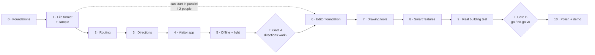

# Inner Map — Build Phases (Prototype)

> Step-by-step plan to build the prototype described in [`PROTOTYPE.md`](./PROTOTYPE.md).
> Each phase is small, ends with **something we can see or test**, and doesn't start until the previous one is "done".
> Started: 2026-10-15 · Status: **not started**

---

## Overview

> **In simple words:** first we build the **brain** (how routes and directions are calculated), then the **phone app** that uses it, test it with real people, and only *then* build the **map editor**. Finally, we map a real building and test everything together.

| Phase | Name | What you can see at the end | Rough effort* |
|---|---|---|---|
| **0** | Foundations | Empty apps run, checks are automatic | 1 day |
| **1** | Map file format + sample building | A hand-made 3-floor "Demo Hospital" file that passes validation | 1–2 days |
| **2** | Routing brain | Tests prove correct routes across floors, step-free, nearest toilet | 2–3 days |
| **3** | Directions brain | Routes turn into readable steps: "Turn LEFT at the Pharmacy (green board)" | 2 days |
| **4** | Visitor app | On a real phone: scan → search → steps → lost → re-route → arrived | 3–4 days |
| **5** | Offline + light + slow-phone test | Works in airplane mode; ≤ 50 KB first visit; smooth on a cheap phone on 2G | 1–2 days |
| 🚦 | **Gate A: "Do the directions work?"** | 2–3 people navigate the demo map successfully | ½ day |
| **6** | Editor foundation | Floors, floor-plan images, zoom/pan, scale, undo/redo, save/load | 2–3 days |
| **7** | Editor drawing tools | Draw paths, drag dots, doors, rooms, lifts/stairs across floors | 3–4 days |
| **8** | Editor smart features | Amenity drag-and-drop, QR stickers + print sheet, live checks, ▶ test route | 3 days |
| **9** | Real building field test | A real building mapped in < 2 h; 5 strangers tested on real phones | 2–3 days |
| 🚦 | **Gate B: "Go / no-go for v0"** | Findings written down, v0 decisions made | ½ day |
| **10** | Polish + stretch + demo | Hindi, mini map, parking spot, demo link, pitch-ready | 2–3 days |

\* *Focused working days, rough. Real calendar time depends on hours per week.* **Total ≈ 4–6 focused weeks.**

**Critical path:** 0 → 1 → 2 → 3 → 4 → 5 → Gate A → 6 → 7 → 8 → 9.
If two people work in parallel, **the editor (6–8) can start right after Phase 1**, because both apps share the same file format.

---

## ✅ "Done" means the same thing in every phase

A phase is done only when **all** of these are true:
- [ ] It works and has been **shown** (demo on screen or phone)
- [ ] Tests pass (`pnpm test`), lint passes (`pnpm lint`)
- [ ] Visitor app is within the **size budget** (`pnpm size`)
- [ ] No `any`, no shortcuts that break the layer rules (core never imports browser code)
- [ ] Docs updated if a decision changed (`PROJECT_CONTEXT.md` / `LOW_LEVEL_DESIGN.md`)
- [ ] Committed with a clear message

---

## Phase 0 — Foundations

> **In simple words:** set up the empty workshop: folders, tools, and automatic checks, so every later phase is fast and clean.

**Tasks**
- [x] `git init`, `.gitignore`, `.editorconfig`, `.nvmrc` (Node 24 LTS)
- [x] pnpm workspaces: `packages/core`, `packages/schema`, `apps/visitor`, `apps/editor`, `samples/`, `tools/`
- [x] TypeScript strict config shared by all packages
- [x] Vitest (tests), ESLint + Prettier, dependency-cruiser (layer rules)
- [x] `apps/visitor`: Vite + plain TS "Hello" page
- [x] `apps/editor`: Vite + Preact "Hello" page
- [x] `tools/size-check.mjs`: compresses the visitor build and **fails above 35 KB**
- [x] Root scripts: `pnpm dev`, `pnpm test`, `pnpm lint`, `pnpm size`, `pnpm build`
- [ ] GitHub repo + GitHub Actions running lint → test → size → build *(workflow ready in `.github/workflows/ci.yml`; waiting for a GitHub remote)*
- [x] Short `README.md` pointing to the design docs

**Done when:** `pnpm dev` opens both apps, CI is green, and a deliberately oversized file makes the size check fail.

**Risk:** spending too long on tooling. **Rule: max 1 day, keep it boring.**

---

## Phase 1 — Map file format + sample building

> **In simple words:** decide exactly **what a map file looks like**, and hand-write a small 3-floor hospital in that format so we can build everything else against it.

**Tasks**
- [x] `packages/schema`: TypeScript types for `fmt: 0` (levels, nodes, edges, connectors, rooms, amenities, qr), per `PROTOTYPE.md` §4
- [x] Zod validation for the file (wrong/missing fields → clear error messages)
- [x] ID rules (unique ids, edges point to existing nodes, connector stops exist on their levels)
- [x] `samples/demo-hospital/demo.json`, hand-written:
  - 3 floors (Ground, 1, 2), each with a color
  - 1 lift (G, 1, 2), 1 staircase (G–1–2), 1 lift that **skips floor 1** (to test that case)
  - 17 rooms (OPD, Radiology, Pharmacy, Lab, Canteen…), 2 rooms with **2 doors** (Radiology, Emergency)
  - Amenities: toilets (incl. accessible), water, ATM
  - 8–10 QR anchors with wall direction
  - Landmark names on all decision points
- [x] A simple diagram (ASCII or SVG) of the demo building in `samples/demo-hospital/README.md`
- [x] Tests: the sample is valid; broken samples produce the expected errors

**Done when:** `pnpm test` validates the demo file, and breaking it on purpose shows a readable error.

**Why first:** the editor, the phone app and the brain all depend on this format. Changing it later is expensive.

---

## Phase 2 — Routing brain (`packages/core`)

> **In simple words:** the code that answers "what's the best way from here to there?". Pure logic, no screens, fully tested.

**Tasks**
- [ ] **Graph builder:** map file → dots + lines in memory; distances computed from coordinates
- [ ] **Connectors → lines:** lift = a line between every pair of its floors; stairs = neighboring floors only
- [ ] **Edge costs** (walk / stairs / lift / ramp) as in `LOW_LEVEL_DESIGN.md` §5
- [ ] **`RouteCostRule` interface** + first rules: `step-free`, `avoid-tags`
- [ ] **A\* search** across floors
- [ ] **Multi-door destinations:** route to the cheapest door of a room
- [ ] **Nearest amenity:** "nearest 🚻 from here" (first one reached by walking, not straight-line)
- [ ] **Result types** (`ok` / `no-route` / `unknown-start`…), no exceptions
- [ ] **Tests:**
  - Golden routes on the demo hospital (same floor, other floor, skipped floor)
  - Step-free route never uses stairs
  - Room with 2 doors → the closer door is chosen
  - Nearest toilet from 3 different spots
  - Unreachable destination → `no-route`
  - Speed: 1,000 random routes on the demo map in < 1 s

**Done when:** all tests pass and a tiny command prints a route (`pnpm route G-E1 Radiology`).

---

## Phase 3 — Directions brain (`packages/core`)

> **In simple words:** turn a list of dots into instructions a stressed hospital visitor can follow.

**Tasks**
- [ ] **`InstructionBuilder`:** merge straight stretches into one step
- [ ] **Turn detection** from angles: straight / slight / turn / turn around
- [ ] **Landmarks in every step:** "Turn LEFT at the Pharmacy counter (green board)"
- [ ] **Only named dots become visible steps** (unnamed dots are only used by the router)
- [ ] **Floor change = 3 steps:** go to lift → ride to Floor X (with floor color) → exit and turn
- [ ] **First step uses the QR wall direction**, or "Walk towards…" if unknown
- [ ] **Arrival step:** "Radiology is on your RIGHT 🎉" (left/right from the last walking direction)
- [ ] **Text templates** in a message file (English now, ready for Hindi): `turn.left.at = "Turn LEFT at {landmark}"`
- [ ] **Step object** includes: text, icon (arrow type), floor, floor color, target dot id (for "✓ I'm here")
- [ ] **Snapshot tests:** full step lists for 6–8 demo routes, read by a human for clarity

**Done when:** `pnpm route G-E1 Radiology` prints human-readable steps that **you** read and approve.

**Review checkpoint:** both founders read the snapshot outputs aloud. If a sentence sounds robotic, fix the template now.

---

## Phase 4 — Visitor app

> **In simple words:** the phone experience: open from a QR, choose where to go, follow steps, recover when lost.

**Tasks**
- [ ] **Design tokens** (`tokens.css`): colors, floor colors, category colors, spacing, radius, dark mode
- [ ] **SVG icon sheet:** arrows (straight, left, right, slight, U-turn), lift, stairs, toilet, water, ATM, pharmacy, lab, lock, wheelchair, QR
- [ ] **Tiny store + state machine:** Locating → Choosing → Routing → Navigating ↔ Lost → Arrived (`LOW_LEVEL_DESIGN.md` §6)
- [ ] **Screens:** Arrive/Search · Step card · Lost · Arrived (mockups in `PROTOTYPE.md` §6)
- [ ] **Start point** from `/?at=QR-CODE`; no `at` → "Where are you?" (room number / list)
- [ ] **Search:** by name, room number, category chips; "Nearest 🚻 / 💧"
- [ ] **♿ Step-free toggle**
- [ ] **Step navigation:** ✓ I'm here · ← Back · progress dots
- [ ] **Lost flow:** scan a QR (camera / `BarcodeDetector` where available) · type a room number · "Do you see any of these?" (nearest named dots)
- [ ] **Re-route to the same destination** when a new QR is opened mid-trip
- [ ] **Session saved on the phone** (3-hour expiry)
- [ ] **Accessibility:** buttons ≥ 48 px, contrast ≥ 4.5:1, screen-reader announces each new step
- [ ] **Test on a real phone** over the same Wi-Fi (`vite --host`) with printed QR codes on your desk/room doors

**Done when:** on a real phone, someone completes: scan → Radiology (other floor) → tap Lost → scan another QR → re-routed → Arrived.

---

## Phase 5 — Offline + lightweight + slow-phone test

> **In simple words:** make sure it's tiny, works without internet, and feels smooth on a cheap phone.

**Tasks**
- [ ] **Hand-written service worker:** precache app shell; map file network-first (2 s timeout) → cached copy
- [ ] **Update flow:** new app version → applied on next open (no broken half-updates)
- [ ] **Size check:** app shell ≤ 35 KB, demo map ≤ 15 KB compressed; **total first visit ≤ 50 KB**
- [ ] **Playwright tests:**
  - Full trip on a **simulated slow 3G/2G network + 4× slower CPU**
  - Second visit with the **network off** → still navigates
- [ ] **Real cheap Android phone test** (~₹6–8k phone), mobile data limited, then airplane mode

**Done when:** all Playwright tests pass and the cheap-phone test feels instant after the first load.

---

## 🚦 Gate A — "Do the directions actually work?"

> Before investing in the editor, prove the core experience with the hand-made demo map.

- [ ] Map the demo file onto **a real space you have access to** (even one floor of your college), with ~8 printed QR codes
- [ ] **2–3 people** who don't know the plan try 3 destinations each
- [ ] Note where they hesitated and which words confused them
- [ ] **Decision:** ✅ continue to the editor · 🔁 fix the directions first (go back to Phase 3/4)

---

## Phase 6 — Editor foundation

> **In simple words:** the empty drawing board: floors, floor-plan pictures, zoom, scale, and undo, before any drawing tools.

**Tasks**
- [ ] **Layout:** top bar · tools (left) · map canvas (center) · properties + issues panel (right) (`PROTOTYPE.md` §5)
- [ ] **Document model** = the same `fmt: 0` structure, held in an editor store
- [ ] **Command pattern:** every change is a command → **Undo / Redo** (Ctrl+Z / Ctrl+Y)
- [ ] **Floors:** add / rename / reorder / color; floor tabs; other floors shown faintly
- [ ] **Floor-plan image** per floor (upload from disk, kept in the browser)
- [ ] **SVG viewport:** zoom (wheel / pinch), pan (drag / space+drag), fit-to-screen
- [ ] **📏 Scale tool:** draw a line → enter meters → `pxPerMeter` saved
- [ ] **Auto-save** to browser storage + **Export / Import** `.json` (validated by `packages/schema`)
- [ ] **Load the demo hospital** from Phase 1 as a sample project

**Done when:** you can create 3 floors with images, set the scale, close the browser, reopen it, and everything's still there. Undo works for every action.

---

## Phase 7 — Editor drawing tools

> **In simple words:** the actual drawing: paths along corridors, dragging dots, doors, rooms, and lifts/stairs connecting floors.

**Tasks**
- [ ] **✏ Path tool:** click-click-click to draw; **snap** to nearby dots (joins paths); Esc / double-click to finish
- [ ] **↖ Select tool:** click / box-select; **drag dots** (connected lines follow); Delete key; arrow keys nudge
- [ ] **Split a line** by clicking on it (adds a dot in the middle)
- [ ] **Line properties:** type (walk / ramp), tags (step-free, outdoor, covered)
- [ ] **🚪 Door tool:** click → door dot connected to the nearest path
- [ ] **🏷 Room tool:** click a door → name, number, category; add extra doors to an existing room
- [ ] **🛗 Lift / 🪜 Stairs:** place once → choose floors served → appears on each floor at the same spot → connect to paths
- [ ] **Properties panel:** edit the landmark name, kind, tags of the selected item
- [ ] **Keyboard shortcuts:** V select, P path, D door, R room, L lift, S stairs, Q QR

**Done when:** you can map the demo hospital **from scratch** in the editor, export it, and the visitor app navigates it exactly like the hand-made file.

---

## Phase 8 — Editor smart features

> **In simple words:** the features that make mapping fast and mistake-free, and the ones that look great in a demo.

**Tasks**
- [ ] **Amenities palette:** drag 🚻 💧 🏧 ☕ 💊 ♿ 🧯 🛐 onto the map → snaps to the nearest dot
- [ ] **🔳 QR tool:** drop on a dot → **drag the arrow toward the wall** → auto code (e.g. `G-E1`) editable
- [ ] **🖨 Print QR sheet:** A4 page of stickers (QR → visitor link, big short code, floor color, "Scan for directions")
- [ ] **Live checks panel** (uses `packages/core`):
  - ❌ unreachable dots, rooms without doors, duplicate QR codes, lifts serving 1 floor
  - ⚠️ decision points without landmark names, lines > 30 m
  - click an issue → zoom to it
- [ ] **▶ Test route mode:** pick start + destination → route highlighted across floors + **the exact visitor steps** in the side panel
- [ ] **"Open on phone"** button: shows a QR code linking the visitor app to this map (same Wi-Fi)

**Done when:** a new person maps one floor using only the editor's checks as guidance, and ▶ Test shows clean steps.

---

## Phase 9 — Real building field test

> **In simple words:** the real exam: map a real building, stick real QR codes, watch real people use it. (Details in `PROTOTYPE.md` §9.)

**Tasks**
- [ ] Get **permission** + floor plans (or photos of fire-evacuation plans) for a 2–3 floor building
- [ ] **Map it** in the editor. ⏱ Record the time (target < 2 h)
- [ ] **Print + stick 10–15 QR codes** (entrance, lifts, main junctions)
- [ ] **5 testers** × 5 destinations (1 other floor, 1 nearest toilet, 1 start without QR)
- [ ] **Observe silently**; note hesitation points and confusing landmark names
- [ ] Repeat 1 trip on a **cheap phone on 2G**, and 1 in **airplane mode**
- [ ] Write the **findings** at the end of this file (§ Findings log)

**Done when:** the results are measured against the 4 prototype goals (`PROTOTYPE.md` §1).

---

## 🚦 Gate B — "Go / no-go for v0"

- [ ] Review the findings together
- [ ] Mapping time < 2 h? Strangers reached 5/5? ≤ 50 KB and offline? Lost-recovery natural?
- [ ] **Decide:** ✅ start v0 (backend, multi-customer, staff access) · 🔁 another prototype round on the weak spots
- [ ] Update `PROJECT_CONTEXT.md` with what we learned

---

## Phase 10 — Polish, stretch goals, demo

> **In simple words:** make it pitch-ready and add the cheap "wow" features.

**Tasks (pick based on Gate B findings)**
- [ ] **Hindi** directions (the templates are ready from Phase 3)
- [ ] **🗺 Mini map:** SVG sketch of the current floor with the route line (+ CSS "draw-on" animation)
- [ ] **📍 Remember my parking spot** (saved on the phone only)
- [ ] **"Staff-only" demo toggle**: clearly labelled as a demo, **not** real security
- [ ] **Deploy to Cloudflare Pages** → a real demo link
- [ ] **Rehearse the 2-minute pitch demo** (`PROTOTYPE.md` §10) with a printed QR sheet

**Done when:** the pitch demo runs smoothly start to finish, on a live link, on a cheap phone.

---

## After the prototype (preview)

Gate B leads into **v0** (see `PROJECT_CONTEXT.md` §11 roadmap and `HIGH_LEVEL_ARCHITECTURE.md` §13):
backend + Postgres/PostGIS · organizations & sites · publish pipeline with chunks · permanent QR resolver · staff login + restricted layers · analytics.

---

## Findings log

*(Filled in at Gate A and Gate B.)*

| Date | Phase / Gate | What we observed | What we changed |
|---|---|---|---|
| | | | |
