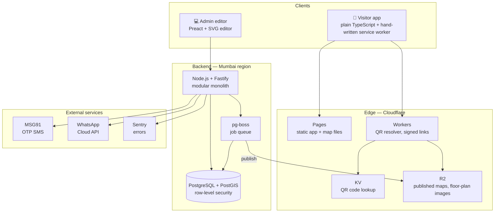

# Inner Map — Tech Stack

> Companion to [`PROJECT_CONTEXT.md`](./PROJECT_CONTEXT.md), [`HIGH_LEVEL_ARCHITECTURE.md`](./HIGH_LEVEL_ARCHITECTURE.md), [`LOW_LEVEL_DESIGN.md`](./LOW_LEVEL_DESIGN.md).
> Started: 2026-10-15 · Status: **proposed — not yet installed**

---

## What we're building (in short)

**Inner Map** is indoor navigation for campuses: **colleges, hospitals, factories**, and later malls, airports and offices.

- A visitor **scans a QR sticker** (or opens a WhatsApp link), picks a destination, and follows **step-by-step landmark directions** ("Turn LEFT at the Pharmacy counter, green board"), tapping **✓ I'm here** at each checkpoint. Lost? Scan any nearby QR and the app re-routes to the same destination.
- **No hardware, no app install, no photos.** It works on cheap phones, on 2G, and **offline** after the first visit.
- **Staff** (electricians, IT, nurses, contractors) log in to see **restricted areas and shortcuts** for their role.
- **Customer admins** draw their map on a floor-plan image in our editor, press **Publish**, and print QR stickers.
- It's a **multi-tenant platform**: one core engine, configured per industry through "packs". Many organizations, each with many sites.

**What the stack must deliver:**

| Need | Target |
|---|---|
| Visitor app size | ≤ 35 KB compressed (app shell) |
| Map data per floor | ~2–10 KB compressed |
| Works offline | After the first visit |
| Cost per extra visitor | ≈ ₹0 (static files on a CDN) |
| Customer data separation | Enforced by the database (row-level security) |
| Data location | India (Mumbai region) |
| Team | 2 founders → one language, few moving parts |

---

## The stack at a glance

---

## 1. Language and project setup

| Choice | Why |
|---|---|
| **TypeScript** everywhere (strict mode) | One language for phone, editor and server → shared `packages/core` (routing works identically everywhere). Interfaces cost 0 bytes. |
| **pnpm workspaces** | One repo, many packages, fast installs, saves disk space |
| ~~Turborepo~~ → **deferred** | Plain `pnpm -r` is enough for 4 packages. Add Turborepo when builds get slow. |
| **Node.js 24 LTS** | Long-term support; pinned with `.nvmrc` |

Versions: latest stable when the repo is created, **pinned** in `package.json` / lockfile.

**Installed at Phase 0 (2026-10-15):** Node 24.13 · pnpm 10.34.7 (also a local dev dependency, so scripts find it on Windows) · **TypeScript 6.0** (not 7: typescript-eslint supports up to 6.0 for now; upgrade once it supports 7) · Vite 8 · Vitest 5 · ESLint 10 + typescript-eslint 8 · Preact 11 · dependency-cruiser 18 · Prettier 3.

---

## 2. Visitor app (📱 the ultra-light one)

| Choice | Why | Rejected |
|---|---|---|
| **Plain TypeScript, no framework** | Every KB counts on 2G | React (~45 KB), Next.js (heavy runtime) |
| **Vite** (dev server) + **esbuild** (production bundle) | Fast development; tiny, tree-shaken output | Webpack (slow, complex) |
| **Hand-written service worker** (~2 KB) | Exactly our cache rules from the LLD | Workbox (bigger than we need) |
| **Plain CSS + CSS variables** (design tokens) | Theming, dark mode, per-customer branding for ~1 KB | Tailwind runtime, CSS-in-JS |
| **Inline SVG icon sheet** | ~3 KB, cached forever | Icon fonts, PNGs |
| **System fonts** | 0 KB | Google Fonts / web fonts |
| **Map sketch = SVG built from data** | 0 KB extra library | **MapLibre (~800 KB)**, Leaflet (~40 KB) |
| **QR scanning:** the phone's camera app (opens our link), plus the built-in `BarcodeDetector` where available | 0 KB | jsQR (~45 KB). Only lazy-loaded as a fallback if really needed |
| **Own tiny `t()` translation function** + JSON message files | ~0.5 KB | i18next (~40 KB) |

---

## 3. Admin editor (💻 can be heavier, used on laptops)

| Choice | Why |
|---|---|
| **Preact** (+ `preact/compat` if a React library is needed) | React-style components at ~4 KB; easy to hire for |
| **Vite** | Same tooling as the visitor app |
| **SVG-based map editor** (to start) | Simple: click, drag and select come free with the DOM. Move to **Canvas** only if huge campuses get slow (open decision) |
| **Zod** | Same validation schemas as the backend |
| **TanStack Query** | Server data fetching and caching |
| **Turf.js** (admin only, never in the visitor app) | Geometry helpers in the editor (snapping, simplifying outlines) |
| **qrcode** + **pdf-lib** | Generate QR codes and printable sticker sheets |

---

## 4. Backend (🏢 one modular monolith)

| Choice | Why | Rejected |
|---|---|---|
| **Node.js + Fastify** | Fast, schema-based validation, good plugin system for our modules | Express (slower, less structure), NestJS (heavy) |
| **Zod** (+ `fastify-type-provider-zod`) | One schema = validation + TypeScript types + API docs | Hand-written checks |
| **Kysely** (type-safe SQL query builder) | We write real SQL (needed for **PostGIS** and **row-level security**) with type safety | Heavy ORMs that hide SQL |
| **pg-boss** (job queue inside Postgres) | Publish jobs, reports, AI mapping. **No extra infrastructure** at Stage 1 | Redis + BullMQ (one more thing to run) |
| **jose** | JWT access tokens | — |
| **pino** | Fast structured logs | — |
| **OpenAPI** (generated from Zod schemas) | API docs for partners and the public API | — |

**Module layout:** `accounts`, `authoring`, `publishing`, `access`, `qr`, `integrations`, `billing`, `analytics`. Each exposes an interface. **No module reads another module's tables.**

---

## 5. Database

| Choice | Why |
|---|---|
| **PostgreSQL 17+** | Reliable, row-level security, JSON support |
| **PostGIS** (flat meter coordinates) | Spatial questions: "which zone is this path inside?", "nearest dot to this toilet", simplifying shapes |
| **Row-level security** on every table | Customer data separation enforced by the database itself |
| **Managed hosting in Mumbai** (e.g. Supabase or AWS RDS, `ap-south-1`) | Data stays in India; backups and upgrades handled for us |
| **Migrations:** plain SQL files, run by Kysely's migrator | Reviewable, no magic |

Analytics events: monthly partitioned Postgres tables at first → a columnar store (e.g. ClickHouse) **only when volume needs it**.

---

## 6. Edge, hosting and storage (⚡ why each visitor costs ≈ ₹0)

| Choice | Used for |
|---|---|
| **Cloudflare Pages** | Visitor app + admin app (static files) |
| **Cloudflare R2** | Published map files (public + **private bucket** for restricted layers), floor-plan images. **No download (egress) fees** |
| **Cloudflare Workers** | **QR resolver** (`/q/:code`), checking signed links for restricted files |
| **Cloudflare KV** | QR code → site/checkpoint lookup, fast worldwide |
| **Backend host in Mumbai** | Runs the Node API + job workers (container-based, e.g. AWS `ap-south-1`) |

Brotli compression and HTTP/2/3 at the CDN come built in.

---

## 7. External services

| Service | Choice | Notes |
|---|---|---|
| **OTP SMS** (staff login) | **MSG91** (Indian provider) | ⚠️ India requires **TRAI DLT registration** of the sender ID and message templates before sending SMS. Takes days, start early |
| **WhatsApp** (v1) | **Meta WhatsApp Cloud API** directly, or a reseller (Gupshup / Interakt) for quicker setup | Meta charges per conversation → pass through to customers |
| **Error tracking** | **Sentry** for admin + API. **Tiny custom error reporter** in the visitor app (the Sentry SDK is too big for our budget) | |
| **Email** (admin invites, reports) | Resend / Amazon SES | |
| **AI floor-plan mapping** (v2) | Claude API (vision) | Photo of an evacuation plan → draft rooms/walkways for the admin to correct |
| **Payments** (Stage 2) | Razorpay | Indian subscriptions, UPI, invoices with GST |

---

## 8. Quality: testing and code rules

| Choice | Used for |
|---|---|
| **Vitest** | Unit tests (routing, directions, access, schema conversions) |
| **fast-check** | Property tests: "a public route **never** uses a restricted path", on thousands of random maps |
| **Playwright** | End-to-end tests on a **simulated 2G connection + 4× slower CPU**, plus offline mode |
| **Size-budget script in CI** | Build fails if the visitor app goes over 35 KB |
| **ESLint + typescript-eslint** | Code rules, no `any` |
| **dependency-cruiser** | Enforces the layer rules (`core` never imports browser/server code, apps never import each other) |
| **Prettier** | Consistent formatting |
| **GitHub Actions** | CI: lint → test → size check → build → deploy preview |
| **Changesets** (later) | Versioning of shared packages |

---

## 9. What we deliberately did NOT pick, and why

| Not using | Reason |
|---|---|
| **Next.js / React in the visitor app** | Too heavy for the 35 KB budget on 2G |
| **MapLibre / Mapbox / Leaflet** | 40–800 KB. Our SVG sketch from map data costs 0 KB |
| **Photos in directions** | Data-heavy. We use landmark text instead |
| **Microservices / Kubernetes** | Too much operational work for 2 founders. Modular monolith first |
| **MongoDB / Firebase** | No PostGIS, weaker customer separation, harder SQL reporting |
| **BLE beacons / native apps** | Hardware cost and install friction. Against our core idea |
| **Redis (for now)** | Postgres handles the queue and caching at Stage 1 |
| **GraphQL** | REST + OpenAPI is simpler for partners and caches better |

---

## 10. Rough monthly cost at Stage 1 (1–5 pilot sites)

| Item | Estimate |
|---|---|
| Cloudflare (Pages, Workers, R2, KV) | Free tier → ~$5/month |
| Managed Postgres (Mumbai) | ~$0–25/month |
| Backend container (Mumbai) | ~$10–25/month |
| Domain(s) | ~₹1–2k/year |
| SMS OTP | Fractions of a rupee per OTP |
| Sentry | Free tier |
| **Total** | **Roughly ₹3–5k/month** |

*Estimates, check current pricing before committing.*

---

## 11. Open decisions ❓

1. **Database host:** Supabase (easier, more features) or AWS RDS (more control, same region as the backend)?
2. **Backend host** in Mumbai: AWS (ECS / Lightsail) or another provider with a Mumbai region?
3. **WhatsApp:** Meta Cloud API directly (cheaper) or a reseller like Gupshup / Interakt (faster setup)?
4. **Admin editor:** SVG first, Canvas later? (recommended)
5. **Brand + short QR domain** to buy before printing any sticker.
